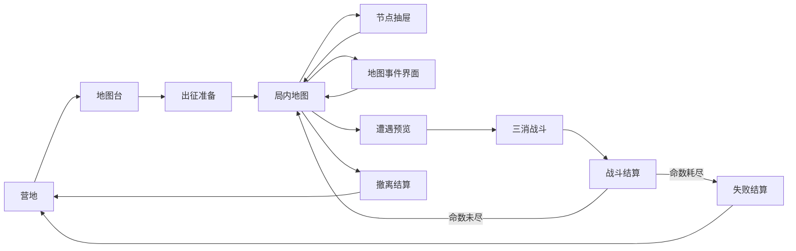

# 深渊远征 · 界面与交互规格（第二版）

本文只写界面、按钮和交互。规则和数值以 `01`–`04` 为准。

框架线框稿（桌面 1440×900，主流程中无争议的 13 屏）：`.superdesign/design_iterations/expedition_framework_1.html`。宠物、工坊、交易行、轮回等规则未定的页面在线框稿里只留占位。

高保真稿 v4（1600×900，营地 / 地图台 / 出征准备 / 局内地图 / 遭遇预览）：`.superdesign/design_iterations/expedition_hifi_3.html`（文件名沿用，页面标题是 v4）。局内地图由 `expedition_mapgen.js` 按种子生成（规则见 `12-map-generation.md`），原型顶栏可以换种子。需要在仓库根目录运行 `python -m http.server 8766` 后打开。

美术：全部页面统一用营地的画风，中等亮度的现代动画风，不做成塑料感的卡通，也不做成古旧暗色。

- 营地和通用图标：`scripts/art-gen/expeditionAnimeAssets.mjs`，成品在 `game-assets/bundled/meta/expedition/anime/`。
- 地图台、局内地面和地标、重画的 12 个图标：`scripts/art-gen/expeditionAbyssAssets.mjs`，成品在 `game-assets/bundled/meta/expedition/abyss/`。重画的图标在页面里通过 `REDRAWN` 表替换旧图，旧图仍在 `anime/`。
- v3 的写实地图台（`scene-device.webp` 等）和写实地貌清单（`expeditionTacticalAssets.mjs`，`xt-*`）不再使用，文件保留。

页面原则：一级页面只放当前要做的决定，每屏一个主按钮；词缀明细、失败损失、背包、队伍、房间内容都放进右侧二级页。队伍卡和敌方卡沿用游戏现有的出战准备卡（`src/meta/screens/regionalScreen.css` 的 `rg-troop`）。界面上不出现步数、明亮度或任何计时数字（`12` §2.2）。

v1（`expedition_hifi_1.html`，暗色手绘风）和 v2（`expedition_hifi_2.html`，固定地图）只留作对照。

v4 通用组件：

| 组件 | 规格 |
| --- | --- |
| 物品框 | 靛蓝底 `#263166`，稀有度只用 1.5–2px 描边加底部一点淡光，不加底部色条，不加发光圈和旋转动画 |
| 主按钮 | 竖向渐变 `#ffd982 → #f4bc56`，1px 深金描边，靛蓝投影，不发光；撤离用绿色版本 |
| 次按钮 | 实心靛蓝底 |
| 标签 | 6px 圆角 |
| 面板 | 全站共用一套 `--panel` 渐变；列表不做斑马纹 |
| 撤销 | 丢弃物品、交换保险格、喝药这类操作完成后，提示条上带 5 秒“撤销” |
| 没做的入口 | 原型里点击提示“原型略”；没开放的选项点击时说明开放条件，不做成点了没反应 |

## 0. 通用约定

### 0.1 尺寸

- 验收视口：桌面 1440×900，移动 390×844。
- 断点沿用现有：≤1000、≤800、≤600。

### 0.2 导航

- 进入 `#expedition/*` 后隐藏外壳的底部主导航，只保留顶栏（货币、背包、邮件、设置），避免两条底栏叠在一起。
- 远征自己的导航：
  - 桌面：顶部页签；
  - 移动：一条底栏，5 项——出征、刻印、仓库、工坊、更多。“更多”里是设施、星图、委托、情报、战报。
- 顶栏左侧固定一个“返回王国地图”按钮。
- 局内地图（U14）全屏，不显示远征导航。

### 0.3 路由

- 旧路由 `#regional*` 一律重定向到 `#expedition`。
- 有进行中的局时，营地顶部常驻“继续远征”条。

### 0.4 写操作

- 每个写操作都调用服务端命令。
- 等待期间按钮进入忙碌态（复用现有 `rg-spinner`），防止重复提交。
- 失败时用 toast 显示 `MetaFailure.message`。
- 成功后只做局部刷新。

### 0.5 二次确认

以下操作需要二次确认，确认框里列出物品的名称和数量：

- 分解（每件可以选收录哪条词缀，见 U07）；
- 每件刻印的第一次破限（提示“之后不能再重铸、升品”）；
- 开启淬火标记（说明确认：列出完成条件，以及“失败即遗失、不能投保”）；
- 路引腐化；
- 放入鸽子格（“本趟不能取出”）；
- 放弃远征、战斗中撤退；
- 魔方继续渴求（激怒概率 ≥ 30% 时）；
- 出征时未投保刻印的重建估价合计超过 6 趟（`11` §6.2）。

工坊的其他操作点主按钮直接执行，不弹框；三级确认的完整口径见 U07。

### 0.6 刻印卡

- 显示：品质色框和品质文字、底材图标、名称、物品等级、潜能圆点、交易状态（可交易 / 绑定）。
- 品质的名称和颜色直接用部队稀有度的 `RARITY_TIERS`（普通 / 精良 / 稀有 / 传说 / 史诗 / 神话），刻印、路引、怪物名字都用同一套颜色。
- 角标：锁定、穿戴者头像、保险格、新获得。

### 0.7 词缀显示

- 路引词缀、怪物词缀、罗盘效果，在移动端都只显示“代价图标 → 收益图标”，点开才看全文（流放 2 0.5 的可读性做法）。
- 地图台和遭遇预览会把多条词缀汇总成一行，例如“怪物生命 ×1.6 · 掉落 ×1.45”。

### 0.8 无障碍

- 图标按钮带 `aria-label`。
- 地图节点可以用键盘移动和选择，并提供列表模式作为替代。
- 遵守 `prefers-reduced-motion`。
- 结算奖励区沿用现有 `#rewardRows` 的语义。

### 0.9 红点

只在以下情况显示：

- 委托里程碑可以领取；
- 设施可以升级；
- 有新刻印；
- 铭文库有新的“已见”条目；
- 某个事件的首领钥匙已经集齐。

## 1. 页面总览

| 编号 | 页面 | 路由 / 形态 | 期 |
| --- | --- | --- | --- |
| U01 | 营地首页 | `#expedition` | 一 |
| U02 | 地图台 | `#expedition/device` | 一（词缀和罗盘在二期） |
| U03 | 出征准备 | `#expedition/prepare` | 一 |
| U04 | 角色刻印 | `#expedition/sigils[/<角色>]` | 一 |
| U05 | 刻印详情与对比 | 弹层 | 一 |
| U06 | 仓库 | `#expedition/stash[/<页签>]` | 一 |
| U07 | 工坊 | `#expedition/workshop[/<操作>]` | 一（升阶、重铸、分解；其余按 `11` §8.5） |
| U08 | 铭文库 | `#expedition/library` | 二 |
| U09 | 营地设施与事件营地 | `#expedition/camp[/<设施>]` | 二 |
| U10 | 星图 | `#expedition/chart` | 三 |
| U11 | 委托板 | `#expedition/contracts` | 三 |
| U12 | 情报 | `#expedition/intel[/<群系>]` | 二 |
| U13 | 补给商人 | `#expedition/shop` | 一 |
| U14 | 局内地图 | `#expedition/run` | 一 |
| U15 | 节点抽屉 | 抽屉 | 一 |
| U16 | 局内背包 | 抽屉 | 一 |
| U17 | 遭遇预览 | 弹层 | 一 |
| U18 | 遗物选择 | 弹层 | 一 |
| E1–E6 | 地图事件界面 | 全屏层 | 按事件分期 |
| U19 | 战斗内补充 | 现有战斗界面 | 一 |
| U20 | 战斗结算扩展 | `#result` | 一 |
| U21 | 撤离结算 | `#expedition/extract` | 一 |
| U22 | 失败结算 | `#expedition/extract` | 一 |
| U23 | 战报 | `#expedition/log` | 三 |
| U24 | 锁定页与新手引导 | `#expedition` | 一 |
| U25 | 交易行 | `#expedition/market[/<页签>]` | 二 |
| U26 | 记忆簿与忆匠 | `#expedition/memories[/<记忆>]` | 二 |
| U27 | 宠物 | `#expedition/pets[/<页签>]` | 二 |
| U28 | 毕业地图 | 待定（`09` 设计后置） | 四 |
| U29 | 深渊轮回 | `#rebirth`（独立入口） | 四 |

战斗无论胜负都先进战斗结算页（U20），再根据命数决定回地图还是进失败结算（AGENTS.md 要求）。

## 2. 营地类页面

### U01 营地首页

布局：

- 桌面：
  - 顶部：标题、远征等级条、赛季名和剩余时间。
  - 左侧约 2/3：本周三个群系卡（中央尖塔 + 2 个轮换）。每张卡显示群系图、本周首领、代表产出图标、敌人主题（例如“元素 · 巨人”）。
  - 右侧约 1/3，从上到下：
    - 事件进度卡：王之召见进度、裂片、梦核 x/4、欲念之核 x/3、猎人等级与传奇首级 x/3、蓝图；有可以挑战的首领时高亮；
    - 本周燃烧灵魂 x/75；
    - 日委托；
    - 仓库容量。
- 移动：纵向排列——继续条、群系卡（横滑）、事件进度、委托、燃烧灵魂。

| 按钮 | 可用条件 | 行为 | 禁用提示 |
| --- | --- | --- | --- |
| 继续远征 | 有进行中的局 | 进入 U14 | — |
| 群系卡 | 群系本周开放，且没有进行中的局 | 只做选择：右侧大卡换成该群系，深渊名和分层见 `12` §2.4；跳转只由“出征”负责 | “先完成当前远征” |
| 出征 | 没有进行中的局 | 进入 U02，带着选中的群系 | — |
| 情报（群系卡） | 总是 | 进入 U12 | — |
| 再来一趟 | 有上次配置，路引和罗盘库存足够 | 按上次配置进入 U03 | “缺少：阶 6 路引” |
| 事件进度卡的条目 | 总是 | 进入对应的事件营地（U09） | — |
| 挑战（事件首领） | 钥匙已集齐 | 进入 U02，自动放入首领路引 | — |
| 深渊轮回 | 暂定：完成任意一个事件的终极首领（毕业定义确定后改为“远征毕业”，见 `09`） | 进入 U29 | “击败任一事件终极首领后开放” |
| 交易行 | 满足交易资格（`06` §4.4） | 进入 U25 | “远征等级 10 级开放” |

### U02 地图台

用途：放入路引、插入罗盘，查看风险和收益汇总；同时也是路引的制作台。

布局：

- 桌面三栏：
  - 左栏：路引库存列表，可以按阶、稀有度、词缀数筛选；
  - 中栏：地图台本体——路引槽、罗盘槽 1–3、群系选择、出征类型（短途 / 标准 / 深潜）；
  - 右栏：汇总面板。
- 移动：路引槽和罗盘槽在上，汇总在中间，库存从底部抽屉打开。
- 画面（高保真稿 v4）：背景是营地画风的地图台插画（`abyss/device.webp`）。槽位是嵌进台面的黄铜托盘，按台面透视压扁（高 = 宽 × 0.42），位置按插画实测：
  - 路引托盘在台面中央 (580, 624)，宽 200；
  - 两个罗盘托盘在左右 (262, 618)、(898, 618)，宽 150；
  - 第三个罗盘托盘在上方 (580, 448)，宽 104，路引有 5 条以上词缀才开放，没开放时画锁，点击说明开放条件。
- 物品用 `abyss/pass-0..3`、`compass-*` 图标，稀有度只用描边颜色表示。库存列表收在点托盘后打开的右侧二级页里，一级页面只留托盘和汇总；路引列表不再放筛选条。
- 罗盘二级页按托盘操作：选中的托盘高亮，可以在两个托盘之间交换、取下；深潜罗盘显示为锁定并写开放条件。
- 换路引后，词缀警告数、难度、“一定会遇到”的事件、营地上显示的携带物、出征准备的消耗和第三托盘是否开放一起刷新。
- 制作二级页：用不了的通货灰显并写原因；重铸先问替换哪一条，再预览“旧 → 新”。

汇总面板：

- 命数；
- 怪物生命、攻击、魔法的倍率（触到上限时标“已达上限”）；
- 五类收益合计；
- 本趟必出现的事件，以及空槽带来的随机事件几率；
- 推荐装备增益，以及你的装备增益（标出：推荐 / 吃力 / 危险）；
- 路引词缀列表（代价 → 收益图标）；每条带“克制提示”，例如“你的队伍有 2 名闪避角色”。

页签“制作路引”：

- 用升品石（加词缀）、重铸石（路引重铸）、破限石（路引腐化）制作路引（规则见 `01` §2.1，通货见 `11` §7.2）；
- 3 张同阶路引合成高一阶。

| 按钮 | 可用条件 | 行为 | 禁用提示 |
| --- | --- | --- | --- |
| 路引槽 | 总是 | 从库存选择路引；阶 1–3 可以选“免费普通路引” | — |
| 罗盘槽 | 路引的词缀数决定开放几个槽 | 打开罗盘选择抽屉：按事件和阶分组，显示库存数量和效果 | “再加 N 条词缀开放此槽” |
| 群系 | 本周开放的群系 | 切换群系，刷新敌人主题和产出 | — |
| 出征类型 | 已解锁 | 切换 | “补给站 3 级解锁深潜” |
| 制作 · 加词缀 / 重铸 / 腐化 | 路引稀有度和通货满足要求 | 服务端抽定后显示新词缀；腐化需要确认 | 写明缺少哪种通货，例如“缺少：升品石 ×1” |
| 合成高一阶 | 有 3 张同阶路引 | 选 3 张合成 | — |
| 下一步：准备 | 路引已放入 | 进入 U03 | — |

### U03 出征准备

内容：

- 队伍区：4 张角色卡，每张显示头像、生命、3 个刻印小图标。旁边是宠物槽：头像、名称、星级与等级、本趟的生效效果，以及“更换”按钮（`08` §9）。带的是战斗宠时，标出队伍里和它对口的部队。出发后本趟不能换宠物。
- 战力条：装备增益、搜刮加成、已激活的共鸣标签。
- 补给腰带：6 格。篝火的免费补给自动填入。药剂最多 2、烟雾弹最多 1，超出上限的格子灰显。
- 失败损失、保险格、风险件数都按当前队伍实际穿戴的刻印计算；保险格可以点开更换，换完提示条带撤销。主按钮写“进入霜渊”（按群系换成对应的深渊名）。
- 保险格：1–3 格。每格可以选“投保一枚已穿戴的刻印”，或“放入一堆仓库物品”。淬火中的刻印不能投保。
- 风险表（`11` §6.2，可折叠）：
  - 每件穿戴刻印一行：类别（抄本件 / 养成件 / 孤品）、重建估价（趟）、本趟能否回潜能；
  - 投保就是把这件放入保险格。投保的刻印不会丢，但本趟不回潜能，行内写明“已投保 · 不回潜能”；
  - 淬火中的刻印标“淬火中”，并写完成条件；
  - 底部：未投保合计（趟），以及失败会丢失的补给、路引和罗盘本身；合计超过 6 趟时，出发需要二次确认。
- 命数显示，以及一句说明：“命数为 0 时全灭，才会丢失”。

| 按钮 | 行为 |
| --- | --- |
| 更换队伍 | 打开现有队伍页的远征模式，完成后返回 U03 |
| 角色卡上的“刻印” | 进入 U04 选中该角色，完成后返回 U03 |
| 宠物槽的“更换” | 进入 U27 的携带页，完成后返回 U03 |
| 自动补给 | 按推荐填满补给腰带 |
| 去购买 | 进入 U13，完成后返回 U03 |
| 保险格 | 打开选择抽屉 |
| 出发 | 必要时二次确认 → 调用 `expeditionStart`（消耗路引和罗盘，锁定队伍）→ 进入 U14 |

### U04 角色刻印

布局：

- 桌面三栏：
  - 左：角色列表，可筛选“出征队伍 / 有刻印 / 全部”；
  - 中：角色详情——头像、3 个刻印位、属性前后对比、生效效果列表（显示合计后的值，以及“已达上限”提示）；
  - 右：仓库刻印列表，支持筛选、排序，每项显示与当前的对比差值。
- 底部：全队共鸣面板，每个标签显示“当前 / 下一档”，点开看各档效果和贡献来源。
- 移动：顶部角色头像条，左右滑动切换；中间 3 个刻印位；点刻印位从底部弹出列表；共鸣面板默认折叠。

| 按钮 | 行为 | 禁用提示 |
| --- | --- | --- |
| 刻印位 | 打开该位的刻印列表；已穿戴时打开 U05 | — |
| 列表中的刻印 | 打开 U05 的对比模式 | — |
| 转移刻印 | 把当前角色的 3 枚刻印转给另一名角色，双方互换 | “远征进行中，出征队伍不能修改” |
| 全部卸下 | 3 枚刻印回仓库 | “仓库已满” |
| 推荐穿戴 | 先预览差值，确认后执行 | — |
| 配装方案 | 3 套方案：保存当前，或载入；载入时逐项列出冲突 | — |
| 共鸣标签 | 弹出各档效果和贡献来源，点击来源跳转到对应角色 | — |

### U05 刻印详情与对比（弹层）

内容：名称、品质、底材、物品等级、潜能圆点、保底加成（例如“保底 +10”）、破限次数（0/3）、淬火标记、隐式属性、词缀（T 级徽章、数值和该档区间、标签）、铭刻行的锁形标记、梦痕、专属特效、神话词缀、共鸣贡献（`11` §1.3、§4.2）。

对比模式：左右两列，下方显示差值——属性、GS、共鸣变化、上限截断提示。

| 按钮 | 上下文 | 行为 |
| --- | --- | --- |
| 穿上 / 替换 | 营地 | 穿上，被替换的回仓库 |
| 卸下 | 营地 | 回仓库 |
| 锁定 / 解锁 | 营地 | 锁定后不会被分解，也不会被批量操作选中 |
| 去工坊 | 营地 | 进入 U07，并选中这枚刻印 |
| 分解 | 营地 | 确认后分解；确认框里可以选收录哪条词缀 |
| 穿上（1 步） | 局内 | 选择角色后穿上；在营火处选“整备”时免费 |
| 放入保险格 / 取出 | 局内 | 移入或移出保险格；淬火中的刻印不能放入 |
| 丢弃 | 局内 | 放在当前节点的地上 |

### U06 仓库

页签：刻印 | 材料 | 路引与罗盘 | 消耗品 | 事件货币。

- 刻印：筛选、排序、多选后批量分解（确认框里每件可以选收录哪条词缀）；仓库 4 级后可以设置自动分解规则。
- 材料：按去向分组——熔炉、王国、工坊、不朽。每行显示“用于：……”，并有跳转按钮。
- 路引与罗盘：按阶列出路引，可以点“去地图台”；罗盘按事件分组，显示阶和遗珍标记。
- 消耗品：数量，以及每项的“出征自动携带”开关。
- 事件货币：裂片、猎人徽记、梦尘（三色）、金库币，每项可以跳转到对应的事件营地。
- 每个物品都显示交易状态：“可交易”“绑定”，可堆叠物品分别显示可交易数量和绑定数量（`06` §3）。
- 可交易的物品带“上架”按钮，进入 U25 的上架流程；带“回收”按钮，按回收商的价格卖给 NPC。
- 溢出区横幅：“溢出区 5 件 · 剩余 70 小时 · 去整理”。

### U07 工坊

规则以 `11-sigil-crafting.md` 为准，界面对应 `11` §8.4，结果显示对应 `11` §8.2。分期按 `11` §8.5：一期只有升阶、重铸、分解；二期加升品、铭刻、定向、加护、遗失记录；三期加破限；四期加淬火。

布局：

- 左栏：刻印列表，分“穿戴中 / 仓库 / 遗失记录”三组。每件显示潜能圆点；有可用升阶时显示角标。
  - 遗失记录只能查看：列出最近 30 天遗失的刻印及其词缀，每条标“铭文库可刻回 T?”，并推荐仓库里词缀匹配的底子（`11` §6.3）。
- 中栏：选中的刻印卡。
  - 每行词缀右侧有“升阶”“重铸”两个小按钮，点了切到右栏对应页签并选中这一行；铭刻行显示锁形标记，不能被选中。
  - 空位一行是“铭刻”。
  - 卡上显示潜能圆点、保底加成、破限次数 x/3、淬火标记。
- 右栏：操作区。
  - 页签只有 7 个动作，按层排列：升阶、重铸、分解（第一层）；升品、铭刻（第二层）；破限、淬火（第三层）。未解锁的页签灰显，并写解锁条件：“首次在阶 3 撤离后开放”“首次在阶 7 撤离后开放”。
  - 选项开关：重铸页有“定向”（选一组：某个机制标签或“属性”）；升阶页有“加护”（本次掉阶算作原地）；破限页也有“加护”（选一行不受震裂影响）。
  - 三段色带，带数字区间，例如“1–55 成功 · 56–85 原地 · 86–100 掉阶”；保底加成单独标出，例如“含保底 +10”。破限页三段是成功 / 无事 / 震裂。重铸页改为显示新词缀的 T 级区间。
  - 消耗和持有量：不足时标红，并给出“去交易行”的跳转（进入 U25 并预设这种通货）。刻尘不能交易，不足时只标红。
  - 主按钮直接写消耗，例如“升阶 · 升阶石 ×3”“重铸 · 重铸石 ×3（定向）”。
- 底部：操作记录。点开任一条，看到的是同一份收据。

| 页签 | 交互 | 主按钮 | 禁用条件 |
| --- | --- | --- | --- |
| 升阶 | 选一条非铭刻词缀；显示 T 级前后的数值、三段色带（成功 / 原地 / 掉阶）和保底加成；可开加护 | 升阶 · 升阶石 ×N（加护时另写“破限石 ×1”） | 潜能为 0；已到物品等级上限（显示“上限 T2”）；升阶石不足 |
| 重铸 | 指定去掉的一条词缀；显示新词缀的 T 级区间；开定向时先选组，列出组内每条候选和概率 | 重铸 · 重铸石 ×1（定向 ×3） | 潜能为 0；重铸石不足；已破限；定向组内没有可抽的词缀 |
| 分解 | 可多选；显示刻尘产出；每件可以选收录一条词缀，默认推荐“高于现有记录的最高一条”，专属特效不能选 | 分解 · 刻尘 ×N | 已锁定、正穿戴、挂单中、淬火中 |
| 升品 | 显示新品质、补齐后的词缀数、潜能上限和当前潜能各 +1 | 升品 · 升品石 ×1 | 已是传说及以上；已破限；升品石不足 |
| 铭刻 | 从铭文库选已录词缀，再选要替换的一行或空位；显示写入 T 级 = min(记录, 物品等级上限)；已有铭刻行时提示“会覆盖原铭刻行” | 铭刻 · 刻尘 ×N | 潜能为 0；刻尘不足 |
| 破限 | 选一条非铭刻的 T1 词缀；显示破限次数 x/3 和三段色带（成功 / 无事 / 震裂）；可开加护 | 破限 · 破限石 ×N（加护另 +1） | 没有非铭刻的 T1 词缀；已破限 3 次；破限石不足 |
| 淬火 | 列出前提（史诗，至少一条 T0）和完成条件（阶 ≥ 8、穿着、不投保、本趟击败首领、成功撤离）；出发前可以取消 | 开启淬火 / 取消淬火（免费） | 不是史诗；没有 T0 词缀 |

确认分三级（`11` §8.4）：

- 普通：升阶、重铸、升品、铭刻，以及同一件的第二、三次破限，点主按钮直接执行。有掉阶或震裂概率且没加护时，按钮上显示红色小字，例如“15% 掉阶”，不弹框。
- 二次确认：分解（列出名称和收录选择）；每件刻印的第一次破限（提示“之后不能再重铸、升品”）。
- 说明确认：开启淬火（列出完成条件，以及“失败即遗失、不能投保”）。

结果弹层（内容全部来自收据）：

- 消耗：真实名称和数量；
- 骰点与色带，例如“掷出 83，T2 需要 ≥ 86”；
- 词缀前后对比，潜能前后对比；
- 获得，例如“刻尘 ×38”；
- 铭文库变化。

结果是“原地”或“无事”时，明确写“无变化”，仍然列出消耗。“再来一次”使用相同参数，生成新的操作 ID，并重新显示消耗。重复提交拿到的旧收据标“已处理”，不重播动画。

桌面：三栏同屏。移动：左栏改为顶部的刻印选择条，刻印卡在中间，右栏改为底部抽屉，页签横向滚动，主按钮固定在底部。

### U08 铭文库

- 总进度，以及分类进度：属性、机制、搜刮、条件、史诗、事件史诗。
- 可按类型、标签、状态（未见 / 已见 / 已录）筛选。
- 页顶一句说明：“分解刻印时可以收录其中一条词缀。只记最高值，低于或等于已有记录时不变。专属特效不能收录。”
- 王国之誓、群系之契满足解锁条件时自动记为已录；首领变体首杀解锁的铭文直接记为已录（`11` §3.4）。
- 条目详情：各 T 级的数值、已录的最高 T 级、全部来源、可用的底材。
- 按钮：
  - “铭刻到…”：选择刻印和要替换的行，进入 U07 铭刻页的右栏确认；
  - 查看来源：跳转情报或事件营地。

### U09 营地设施与事件营地

- 营地插画上有可点击的建筑（移动端改为卡片列表）：地图台、仓库、工坊、铭文台、补给站，以及 6 个事件营地。
- 通用设施面板：当前等级效果、下一级效果、升级消耗（显示持有量，不足标红），以及“升级”按钮。

各事件营地的子页：

| 子页 | 内容 | 按钮 |
| --- | --- | --- |
| 血祭 · 王之召见 | 进度条（x/3000）；延期名录（最多 5 件，每件显示下次的价格） | 挑战雾中之王（进度满时可用）；扩容名录 |
| 魔方 · 欲念之核 | 核心数 x/3；星图结晶结转余额 | 挑战极欲之主 |
| 裂隙 · 孵化台 | 放入孵化胚；三棵孵化树；裂片余额；孵化预览（词缀标签权重、物品等级、最少词缀数） | 孵化；重置孵化树（免费）；合成裂隙石（300 裂片） |
| 猎金 · 猎人公会 | 猎人等级与升级进度；已击败目标的图鉴（每名目标的专属掉落表）；悬赏令、加码券、追踪符货架；传奇悬赏进度 | 购买悬赏令（选一名已击败的目标）；购买加码券、追踪符；提升猎人等级；挑战无面猎手（集齐 3 枚传奇首级时） |
| 梦境 · 灌注台 | 梦尘三色余额；配方簿（已发现的组合 → 梦痕）；选择刻印和组合 | 灌注（需确认，会覆盖已有梦痕） |
| 金库 · 金库商 | 用金库币购买指定记忆的指定编号碎片（显示你缺哪几块）；蓝图库存 | 购买；合成大金库路引 |

### U10 星图

- 1 个核心星群 + 6 个事件星群，用一张横向可拖动的星图显示；移动端可以按星群分页查看。
- 节点颜色区分五种写法：出现率、改变形态、代价交换、货币转换、全局规则。
- 每个节点显示效果文字；代价交换类节点要把“失去什么”写在前面。
- 顶部显示各星群的剩余点数。

| 按钮 | 行为 | 禁用提示 |
| --- | --- | --- |
| 点亮 | 消耗该星群的 1 点 | “需要先点亮相邻节点” / “点数不足” |
| 方案 1 / 2 / 3 | 切换方案 | 远征进行中禁用 |
| 洗点 | 消耗刻尘，返还该星群全部点数 | 远征进行中禁用 |

### U11 委托板、U12 情报、U13 补给商人

- U11 委托板：日委托 3 条、周委托 3 条，以及周累计里程碑。按钮：换一个（每天 1 次）、追踪（最多 3 条）、领取（只用于周里程碑；其余委托在撤离时自动结算）。
- U12 情报 · 群系图鉴：每个群系一页，四个页签。
  - 概览：生态一句话、群系标记及对策、特殊宝石、敌人主题（种族和王国）、本周首领、产出类别（只写“常见 / 少见 / 稀有”）。
  - 独有敌人：每名独有敌人一张卡，显示立绘、阶级、定位、法力色、技能和特质。没遇到过的显示剪影和“未遭遇”。
  - 领主与首领：显示阶段、各阶段机制、专属掉落、首领铭文是否已解锁、已见过的变体；未击败的只显示第一阶段。
  - 专属节点：玩法说明和可能的产出。
  - 按钮：去出征（进入 U02 并选中该群系）、查看铭文（进入 U08）。
- U13 补给商人：消耗品（每日限量）；阶 1–3 普通路引；一阶通用罗盘（少量）。另有“回收商”页签：选择仓库里的可交易物品，按固定低价卖给 NPC，换刻尘（`06` §4.6）。

## 3. 局内页面

### U14 局内地图

HUD（顶部，一行）只放这几样，不显示步数、明亮度或计时：

- 菜单（左上，点击在按钮下方展开：暂离 / 冰潮记录 / 列表模式 / 放弃远征）；
- 深渊名、阶、当前所在的层（“霜渊 · 阶 6 · 第一层 · 雪檐林地”）；
- 命数：心形图标 × N。

- 左下：队伍栏，4 名队员的头像和生命条、宠物头像（战斗宠带充能条，远征内跨战斗保留）、遗物数。点开是队伍与遗物二级页。
- 右下：药剂、背包（9/16），找到血祭祭坛后多一个血祭按钮。撤离不放在底栏，站在撤离点上时在浮窗里出现。
- 中间：地图，占满整屏，HUD 和底栏浮在上面。画法照《黑色幸存者》的区域图：一块高原切成 15–23 个有地名的区域，只能走到有通道相连的相邻区域。三个环是往下的三层，层和层之间画成台阶；地面和地标用营地画风的贴图，按种子拼出来（`12` §2.3、§7）。
  - 每个区域显示地名和一个类型标记。标记是深色圆底加彩色线条图形，只有撤离点和首领殿是实心的。
  - 没看清的区域盖一层雾纹，标记位置画两道雾线，地名牌变暗、边框改虚线。走到相邻区域就能看清。
  - 通道画成门的小圆点，同一层相邻但走不通的边界画成冰裂缝。
  - 撤离点下方挂绿色标签，只写状态，不写步数：稍后开放 / 可撤离 / 冰潮将至 / 快封了（呼吸闪烁）/ 最后的出路 / 已封闭。冰潮快到时标签上长出一段紫色冰凌。
  - 冰潮（`12` §2.2）：已封的区域盖白色冰面；下一批要封的画紫色双虚线，区域内侧的霜边随时间变宽，快涨时虚线加速并有一句轻提示“脚下的冰在响，冰潮快涨了”；整局进度画成地图外轮廓上一圈变宽的霜边。最后一段时间里不再逐个标出下一批，只把最后一个开着的撤离点标成“最后的出路”。
  - 冰潮上涨时顶部播报：标题写封了哪里（最多两个地名，多了写“又封住了一片”），副标题只写一句：被推开 > 撤离点被封 > 进入新的一层 > 下一批在哪。点播报打开冰潮记录。
  - 站的区域被封时，头像沿路滑到被推去的区域，队员头像闪一下并飘出“-15%”。
- 选中区域后画出最短路线，并在区域旁弹出浮窗。浮窗避开路线摆放，写地名、类型、在第几层、说明；按钮写“前往”，下面一行写“经过 X、Y”或“经过 N 个区域”，路上有会被冰潮封住的区域时加“· 有冰潮”。房间的完整内容在 U15。
- 事件追踪：本趟每个事件的状态放在血祭按钮打开的二级页里，例如“血祭：名单 5/8，祭坛未激活”。

| 交互 | 行为 | 禁用提示 |
| --- | --- | --- |
| 点击区域 | 选中区域，画路线，弹浮窗 | — |
| 再点一次选中的区域 | 取消选中 | — |
| 点自己所在、没什么可做的区域 | 不弹空浮窗，相邻能去的区域闪一下 | — |
| 前往 | 沿路线逐格移动，遇到任何事件就停下；服务端返回事件后依次播放 | 浮窗不出按钮，改写“冰潮封住了这里，过不去了” / “冰潮把路封死了，过不去” |
| 到达有内容的区域 | 打开 U15，或打开对应的地图事件界面 | — |
| 遭遇 | 打开 U17 | — |
| 药剂 | 先弹确认卡，写清每人回复到多少，点“喝下”；喝完 5 秒内可撤销 | “药剂用完了” |
| 撤离（撤离点浮窗里） | 打开撤离确认二级页：列出带回去的东西和留下的东西，绿色主按钮“撤离” | 未开放时写“稍后开放” |
| 打开任何二级页 | 浮窗先收起 | — |
| 菜单 → 冰潮记录 | 下一批在哪、各撤离点状态、已经封了哪些、什么时候被推开过 | — |
| 菜单 → 列表模式 | 区域以文字列表显示 | — |
| 菜单 → 暂离 | 回营地，局完整保留，冰潮停在原处 | 有未结算的战斗时不可用 |
| 菜单 → 放弃远征 | 二次确认，列出将丢失的物品 → 进入 U22 | — |

### U15 节点抽屉

| 类型 | 内容 | 按钮 |
| --- | --- | --- |
| 搜刮（补给箱 / 战利品堆 / 矿脉） | 物品逐件列出，可以一件件拿；没拿的留在原地，下次来还在。只有第一次搜要花时间，冰潮快到时写明 | 拿取；全部拿取；替换（背包满时） |
| 上锁宝箱 | 同上 | 撬锁 / 用钥匙 / 用撬锁器 |
| 奇物 | 插画、描述，2–3 个选项；每个选项下写明代价和概率 | 选项按钮；继续 |
| 营火 | 三选一，先选再确认；底部一行写这次会不会赶上冰潮（例如“生火要花些时间，这次冰潮还涨不到”） | 休整 / 侦察 / 整备 → 生火 |
| 神龛 | 祝福卡，先选再确认，同样写冰潮提示 | 选一项 → 祈祷 |
| 行商 | 货架，钱袋余额 | 购买；出售；刷新（一次，价格翻倍） |
| 撤离点 / 秘道 | 窗口状态；游荡敌人距离 1 以内时显示警告 | 开始撤离（引导 1 步） |
| 首领殿 | 首领预览（变体和词缀） | 挑战 / 离开 |
| 首领传送门 | — | 立即撤离 / 继续探索 |

### U16 局内背包

页签：背包、保险格、已穿戴、合成。

- 物品操作：使用、穿上（1 步，营火处免费）、放入保险格、丢弃（放到地面）、详情。

### U17 遭遇预览

- 敌人类别：驻守、游荡、稀有怪巢、领主、群系掠食者、悬赏目标、事件、先行者（镜像，显示玩家名）、NPC 探险者、首领。
- 群系标记：本场独有敌人带的群系标记，以及一行对策提示，例如“霜噬：对冻结目标骷髅伤害 ×1.3。带冻结免疫或净化”。
- 敌方 4 张卡：怪物稀有度色名、经过缩放后的属性、原生特质、怪物词缀（每条带一行打法提示）。
- 被原生特质覆盖的词缀灰显，并标注“被原生特质覆盖，不生效”。
- 冲突提示：例如“敌方开局风暴会覆盖你的烈焰共鸣风暴”。
- 伏击状态；我方生命摘要；胜利后的收益类别。

| 按钮 | 可用条件 | 行为 |
| --- | --- | --- |
| 开战 | 总是 | 调用 `expeditionEngage` → 进入三消战斗 |
| 调整出场顺序 | 总是 | 拖动排序 |
| 退回 | 驻守、稀有怪巢、首领殿，且尚未交战 | 回到上一个区域（按钮写“退回 X”）；回去的路被冰封时禁用 |
| 烟雾弹 | 游荡、先行者遭遇，且持有烟雾弹 | 脱离遭遇；没有烟雾弹时不显示按钮，改写“烟雾弹用完了，只能迎战” |
| 关闭（X / Esc） | 只在从地图上“看敌人”打开的预览里 | 回到地图；走到这里触发的遭遇不能关，只能战斗、退回或用烟雾弹 |

- “怎么打”一行：把 4 名敌人的词缀对策去重后直接写出来，例如“技能伤害（荆棘 ×2）”，触屏不用悬停也能看到。
- 胜利收益按生成器给的结构化奖励（图标、名称、说明）显示；战斗结算页只显示这一场实际入账的东西（AGENTS.md），背包放不下、留在原地的单独列出。

### U18 遗物选择

- 三选一，每张卡写明效果和上限。已满 6 枚时，选完后会要求替换掉一枚。
- 可以跳过，跳过得 1 个小钱袋。

### E1–E6 地图事件界面

所有事件界面都有：

- 顶部：事件名、状态条（每个事件不同）、当前事件货币；
- 底部：主按钮和“离开”；
- 右上角：规则说明（问号按钮）。

**E1 血祭**

- 地图层：祭坛节点和献祭范围在地图上高亮；事件追踪条显示名单数量。
- 名单面板：最多 8 张单位卡，按上场顺序排列，每张显示稀有度和贡品值；底部显示贡品合计。
- 主按钮“激活祭坛（2 步）”：确认框写明“将进行一场 N 名单位的车轮战”。
- 恩惠商店：8 格；每格有“购买（贡品价）”和“延期（15%）”两个按钮，延期名录满时延期灰显。
- 底部：重抽（显示费用）；献给王（显示剩余贡品，以及王之召见进度会变成多少）；离开（未花完的贡品作废，确认框里写明）。

**E2 魔方**

- 中央是魔方，下方是已经翻开的卡（奖池），右侧是怒气条。
- 主按钮写成“渴求（10 结晶 · 激怒 23%）”，把概率直接写在按钮上。
- 次按钮“满足：带走奖池”。
- 激怒时播放魔方暴怒的动画，然后进入极欲化身战。

**E3 裂隙**

- 地图层：裂隙区域罩上紫色效果，临时节点出现，HUD 增加“裂隙剩余 N 步”。
- 每场裂隙战开始前显示“S 评级：≤ T 回合”。战斗中顶部显示当前回合和目标回合。
- 战斗结算页显示评级、裂片数和时长变化。

**E4 猎金**

- 悬赏板（外环节点打开）：
  - 3 张悬赏卡，每张显示目标立绘、名称、阶级、首领专属词缀、基础赏金、期限、位置类型（巢穴 / 游荡）；
  - 已接悬赏的数量 x/2，以及当前连猎倍率；
  - 按钮“接取”，满额时禁用并提示“先完成一张悬赏”。
- 地图层：
  - 已接的目标在地图上有专属标记；
  - 游荡目标的踪迹显示为逐步变淡的脚印；有野兽部队时，还显示下一步的预告箭头；
  - 事件追踪条显示每张悬赏的剩余期限，最后 3 步变红。
- 加码面板（在遭遇预览里，只对悬赏目标出现）：
  - 4 条可选加码，每条写代价和赏金倍率，最多选 3 条；
  - 实时显示赏金计算：基础 × 加码 × 连猎 × 赏金猎人，例如“1200 × 1.95 × 1.25 × 4 = 11 700”；
  - 赏金猎人倍率旁显示来源部队的头像和升阶稀有度；没有这类部队时，显示“队伍中没有赏金猎人”，并可以跳转到图鉴筛选带该特质的部队；
  - 按钮“锁定并开战”。
- 结算：战斗结算页显示“赏金 +N（钱袋，尚未带出）”“猎人徽记 +N”，以及连猎倍率变化。

**多阶段战斗（领主与首领）**

- 遭遇预览：在首领卡下方显示阶段格“阶段 1/3”，并列出每个阶段的形态名和关键机制。
- 战斗 HUD：阶段格常驻；进入下一阶段时显示一条横幅，例如“霜巨人督军 · 第二阶段：狂怒”。

**E5 梦境**

- 竖向层级条（1–6 或 1–8），当前层高亮。
- 泡影面板：当前泡影里的物品和梦尘，下一层会如何升级。
- 下潜前：从 2–3 条梦魇词缀里选 1 条加给敌人。
- 每层胜利后有两个按钮：
  - “醒来：带走泡影”；
  - “下潜（噩梦 30%）”。
- 噩梦时，界面换成噩梦色调，然后进入噩梦战。

**E6 金库**

- 顶部是警戒条（0–100，阈值处有刻度），旁边一排技能图标，表示队伍里哪些种族提供了技能。
- 在每个保险柜节点上，搜刮按钮写明“+18 警戒”（已经按技能修正）。
- 封锁时：屏幕边缘变红，增援倒计时出现，“破墙（2 步）”按钮出现。

### U19 战斗内补充

- 顶部标签：“阶 5 · 寒冬堡垒”，以及当前的事件标签（例如“裂隙 S ≤ 9 回合”）。
- 宠物：在我方队伍旁显示宠物头像和充能条（例如“红 5/8”），不占部队位；4★ 满能时头像发光，可以点击释放；宠物宝石带爪印，猎犬的猎物头上有角标（`08` §9）。
- 多阶段战斗：显示阶段格。
- 认输按钮改名为“撤退”，确认框写明“扣 1 命数，全队失去 15% 当前生命”。
- 开局生命按局内实际值。
- 新增的特殊宝石（结晶宝石、裂隙宝石）需要贴图和匹配反馈。

### U20 战斗结算扩展

胜负都显示：

1. 本场实际获得：经验、职业经验、首领变体首杀解锁的铭文；本场触发首胜、里程碑、周活动时直接发放的通货（含宝石），数量和钱包实际增量一致。
2. 放入背包（尚未带出）：
   - 掉落；
   - 做装通货，写真实名称和数量，例如“升阶石 ×3”“破限石 ×1”；
   - 宠物粮、宠物蛋和宠物带来的产出，标出来源，例如“宠物粮 ×6”“乌鸦蛋 ×1”“钱袋 +60 金币（其中老鼠：赃物宝石 ×3，+30）”“猎犬：稀有刻印 · 霜纹之握 ×1”；
   - 战斗内收集的金币和灵魂折算成的钱袋、魂瓶；
   - 事件货币（欲念结晶、裂片等）；
   - 地面遗留物品；
   - 撤退时遗失的物品。
3. 事件结果：裂隙评级、金库警戒变化等。击败首领时，若有淬火中的刻印，加一行文字“淬火条件已满足，撤离后生效”（不是奖励卡）。
4. 命数变化，例如“全队阵亡：命数 3 → 2，濒死撤回”。

失败、重放防重、没有实际发放的内容一律不显示；战败时猎犬不发额外战利品，页面也不显示。页面不重新抽奖。

远征外的战斗共用这个结算页。带宠物时，金币行写“金币 +1,240（其中老鼠 +40，本周宠物金币剩余 18,760）”，到达上限写“+0（本周已满）”。宠物不产出宝石（`08` §10）。

按钮：

- “返回地图”（命数未耗尽时）；
- “查看失败结算”（命数耗尽时，进入 U22）。

### U21 撤离结算

按以下顺序显示：

1. 本趟实际入账：按来源分组（搜刮、战斗、各事件、首领），每项写真实名称和数量；包括做装通货（例如“升阶石 ×9”）、事件货币结转后的永久物品、委托奖励、自动分解、鸽子格里的物品。
   - 宠物粮、宠物蛋按来源分组，写真实数量；
   - 蛋写孵化结果，例如“乌鸦蛋 ×1 → 乌鸦 2★（星级进度 1/2）”或“→ 新宠物：鼹鼠”。
2. 刻印变化：逐件列出“潜能 a → b”和淬火结果，例如“成为神话，获得神话词缀：双纹”。
3. 燃烧灵魂周上限说明（文字，不是奖励卡）。
4. 远征经验和升级。
5. 铭文库新增的“已见”条目。
6. 各事件的长期进度变化，例如“王之召见 +420”“裂片 +86”。
7. 仓库溢出提示。

按钮：返回营地、整理仓库、再来一趟。

结算按 `runId` 幂等。

### U22 失败结算

- 失败原因（命数耗尽，或最后一次冰潮时还在深渊里）。
- 遗失清单：逐项列出刻印（含淬火中的刻印）、做装通货、宠物蛋、宠物粮等的真实名称和数量。
- 保留清单：保险格、鸽子格里保留的物品单独列为“保留”，不算获得。
- 本趟已经永久入账的内容：经验、首领铭文、献给王的贡品。这样玩家能看清“哪些不会丢”。
按钮：返回营地；用阶 1–3 的普通路引再出发。

失物池是后台机制（`01` §5.1），任何页面都不展示它的存在、内容或期限。寻回的刻印和普通掉落显示方式完全一样。

### U23 战报

- 最近 30 趟：日期、群系、阶、路引词缀数、事件、结果、用时、带出数量和遗失数量。
- 详情：地图路线回放、战斗列表、事件结果、物品时间线。
- 不显示“我的镜像被谁击败”。

### U24 锁定页与新手引导

- 锁定页：
  - “满 10 级王国 31/42”；
  - 未满级王国列表，每行有“前往升级”；
  - 剩余金币合计。
- 新手引导：一趟固定 seed 的短途图，必定出现血祭和魔方。分步引导：
  1. 移动；
  2. 搜刮；
  3. 放入保险格；
  4. 在祭坛范围内战斗；
  5. 激活祭坛并购买恩惠；
  6. 魔方抽 2 次后收手；
  7. 撤离。
- 引导结束赠送一套精良刻印和 2 张阶 4 路引。

### U25 交易行 `#expedition/market[/<页签>]`

规则见 `06`。五个页签：浏览、我的挂单、求购（三期）、收件箱、记录。

**浏览**

- 左侧：品类树——刻印、交易货币、做装通货、路引、罗盘、事件货币、局外材料。
- 中间：
  - 可堆叠物品：订单簿视图。显示卖一到卖五、买一到买五的价格和数量，7 日中位价，成交量，最近 10 笔成交，价格折线图。
  - 刻印：列表视图。每行是一张刻印卡、标价，以及“相似刻印近期成交价”的参考区间。
- 刻印的筛选：品质、底材、物品等级、词缀（可以多选，每条可以设最低 T 级）、专属特效、标签、潜能下限、价格区间。可以保存 5 组常用筛选。
- 移动端：品类树改成顶部的下拉框，筛选面板从底部弹出，列表一行一件。

| 按钮 | 可用条件 | 行为 | 禁用 / 失败提示 |
| --- | --- | --- | --- |
| 购买（刻印） | 余额足够，未达每日成交额度 | 确认框显示总价和“购买后绑定，不能再上架”→ 服务端冻结货币并撮合 → 进入收件箱 | “已被他人买走”“余额不足”“今日额度已用完” |
| 买入（可堆叠物品） | 同上 | 输入数量和限价；按卖单从低到高吃单，未成交的部分可以选择挂成买单 | 同上 |
| 对比 | 刻印 | 打开 U05 的对比模式，和自己某名角色当前穿戴的刻印对比 | — |

**上架**

入口：U05 或 U06 的“上架”按钮，以及本页右上角的“出售”。

- 选择物品：只列出可交易的物品。
- 可堆叠物品：输入数量和单价。
- 刻印：输入一口价。
- 页面显示：7 日中位价或相似刻印的成交参考、允许的价格区间、上架费、预计成交税、到手金额、有效期 48 小时。
- 按钮“确认上架”：物品转入托管。

**我的挂单**

- 列出每一条挂单：物品、价格、已成交数量、剩余时间。
- 按钮：撤单（物品退回收件箱，上架费不退）、改价（等于撤单后重新上架，重新收上架费）。

**收件箱**

- 已买到的物品、已卖出的货款、过期退回的物品。
- 按钮：领取（逐件，或全部领取到仓库）。仓库满时显示“仓库已满，物品保留到某月某日”。

**记录**

- 我的成交历史，每条显示交易 ID、物品、价格、税费、时间。

**封禁状态**

- 交易权限被冻结时，交易行顶部显示“交易权限审核中”，所有写按钮禁用；收件箱仍然可以领取。

### U26 记忆簿与忆匠 `#expedition/memories[/<记忆>]`

规则见 `07`。

- **记忆簿**：所有记忆的网格，每份记忆显示：
  - 拼图缩略图：已有的碎片亮，缺的暗；
  - 进度，例如 7/9；
  - 产出类别；
  - 限定来源。
  
  可以按产出类别和完成度筛选。
- **单份记忆的详情页**：
  - 整张拼图，每块碎片标编号，并显示持有数量（重复的显示 ×2、×3）；
  - 缺的碎片显示来源：哪个群系、哪个首领、哪个事件；
  - 交易行这一块的当前最低价。

| 按钮 | 可用条件 | 行为 | 禁用提示 |
| --- | --- | --- | --- |
| 拼合 | 全部碎片都有 | 消耗每个编号各 1 块，得到一份完整的记忆 | “还缺 2 块：#3、#7” |
| 唤醒 | 有完整的记忆 | 结果弹层逐项列出获得的熔炉材料名称和数量 | — |
| 进入忆境 | 有完整的记忆 | 显示谜题规则（敌人、回合上限、击杀目标），确认后开战 | — |
| 置换 | 同一份记忆有 3 块重复碎片 | 换 1 块随机的缺失碎片，结果揭示 | “重复碎片不足 3 块” |
| 买缺失碎片（忆尘） | 忆尘足够 | 指定编号购买 | “忆尘不足” |
| 去交易行 | 总是 | 进入 U25，并预设筛选为这一块碎片 | — |
| 分解重复碎片 | 有重复碎片 | 换成忆尘，需要确认 | — |

### U27 宠物 `#expedition/pets[/<页签>]`

规则以 `08-pets.md` 为准，界面对应 `08` §9。

- 首次进入：第一趟出发前弹出“选一只宠物”，狐狸或松鼠二选一。
- 页签：
  - 携带：宠物卡、“设为携带”；分模式说明，逐行写本宠在该模式的实际效果，或“关闭”。远征出发后锁定，本趟不能换。
  - 喂养：宠物粮数量滑块、“喂到上限”、“升星（消耗 2 颗狐狸蛋）”；显示等级上限和下一个数值台阶（Lv10 / 20 / 30）。
  - 图鉴：每只宠物的一句话规则、2★ / 5★ 规则、蛋的来源；“3 换 1”（3 颗多余的蛋换 1 颗指定种类的蛋，换出的蛋绑定）。
- 出征准备（U03）：宠物槽、“更换”；带的是战斗宠时，标出队伍里和它对口的部队。
- 战斗（U19）：
  - 宠物头像和充能条（“红 5/8”），点击查看规则；4★ 满能时头像发光，点击释放，不消耗回合；
  - 宠物宝石带爪印；猎物头上有角标；
  - 远征外显示“3★ 规格”；PvP 等关闭宠物的模式，头像显示“休眠”。
- 地图（U14）：松鼠在节点上显示品质色点；鼹鼠显示“再挖一次（1 步）”按钮；鸽子格带锁图标，放入时二次确认“本趟不能取出”。

### U28 毕业地图

设计后置（`09-pinnacles.md`），界面待定。

### U29 深渊轮回 `#rebirth`

规则以 `10-rebirth.md` 为准，界面对应 `10` §6.6，结算对应 `10` §6.4，分期见 `10` §6.7。

- 入口页：开局选择（每个开局一句话，未解锁的写解锁条件）、深度（0–10，显示已通关的最高一档）、每日挑战、组合图鉴。
- 层进度条：4 个格子（战斗 → 岔路 → 商店 → 首领），当前格高亮，并标第几层。
- 岔路：两张门卡，每张显示敌方颜色、敌方道具、悬赏开关（写明悬赏条件和“敌人生命 +25%”）。首领门写一句针对哪种打法的提示。
- 战斗 HUD：
  - 左侧 6 个道具图标，每个下面 4 个次数点，用掉变暗；
  - 道具触发时图标亮起，屏幕边缘显示触发记录，例如“雷管 → 震地锤 → 导火索 ×2”。
- 奖励三选一 / 商店：
  - 卡面为“条件图标 → 结果图标 + 一句话”；
  - 新道具能和已有道具接上时，两张卡之间画线，写“能接上：雷管”；
  - 道具栏 6 格，满了要先卖出；商店里有卖出、刷新、回复生命、招募部队，按钮写价格。
- 本局总结：最长连锁、各道具触发次数、一次交换最高伤害。
- 组合图鉴：按道具两两排列，已发现的写“A → B”，空格显示问号和条件图标提示。

| 按钮 | 可用条件 | 行为 | 禁用提示 |
| --- | --- | --- | --- |
| 开始 | 已选开局和深度 | 开新局，进入第 1 层 | — |
| 每日挑战 | 总是 | 用当天的种子、开局和可选部队开局 | — |
| 门卡 | 岔路步骤 | 选这扇门；悬赏开关在门卡上切换 | — |
| 拿取（奖励卡） | 道具栏未满 | 拿走这件道具 | “道具栏已满，先卖出一件” |
| 卖出 | 有道具 | 确认后卖出，返还本局金币 | — |
| 放弃本局 | 不在战斗中 | 二次确认后结束本局，不发账号奖励 | — |

结算（`10` §6.4）：

- 本局金币、道具、队员、悬赏奖励只显示在战斗结算之后的本局奖励页，不出现在“本场实际获得”。
- “本场实际获得”只列账号入账：外观、称号、解锁项、组合图鉴新条目，用真实名称和数量，例如“+1 称号·深渊归来者”“+1 组合图鉴·雷管 → 震地锤”。
- 战败只显示实际发放的内容，未达成的不显示。重复回传、重载恢复复用原收据，只入账一次。
- 本模式不发宝石。

## 4. 缺失状态的处理

| 情况 | 处理 |
| --- | --- |
| 局进行中遇到周轮换或赛季结束 | 本局按开始时的群系和规则继续，结束前不受影响 |
| 撤离引导中断线 | 重进后引导继续，已经消耗的步数不退 |
| 有未结算的战斗时想暂离 | 不允许暂离，只能开战、撤退或重开 |
| 失败时仓库已满 | 保险格物品进入溢出区 |
| 开局 0 步就放弃 | 路引和罗盘已经消耗，不退还；放弃确认框里写明 |
| 镜像池为空 | 先行者全部用 NPC 探险者，并标注 |
| 怪物词缀被原生特质覆盖 | 遭遇预览中该词缀灰显 |
| 事件界面中断线 | 服务端保存事件状态，重进后回到同一步（魔方奖池、已接悬赏和加码、梦境层数都保留） |
| 交易行投递中断线 | 收件箱以服务端为准，重进后显示已经到账的内容；不重复投递 |
| 买入的物品在仓库满时到达 | 留在交易行收件箱 7 天 |

## 5. 需要改动的现有页面

| 编号 | 页面 | 改动 |
| --- | --- | --- |
| M01 | `mapScreen.ts` | 入口改为远征；未解锁时显示 x/42；王国总览改为 15 格 |
| M02 | `kingdomSheet.ts` | 15 级轨道；11 级以上同时显示金币和纹章；精通改为 ⌈等级/2⌉；“纹章来源”跳转情报页 |
| M03 | `heroScreen.ts` | 精通面板改新口径 |
| M04 | `bagScreen.ts` | 新增分类；燃烧灵魂来源改为远征 |
| M05 | `teamScreen.ts` | 去掉区域过滤；新增远征模式；远征进行中锁定出征队伍 |
| M06 | 熔炉 | `#soulforge` 新路由与分类；材料缺口可以跳转到对应的事件营地 |
| M07 | 不朽升级 | 燃烧灵魂来源文案 |
| M08 | 邮件 | 精通迁移通知；溢出区到期的分解通知 |

## 6. 埋点

- 漏斗：解锁 → 引导完成 → 第一次自制路引 → 第一次插罗盘 → 第一次击败事件首领。
- 每趟：路引词缀数、罗盘组合、参与的事件、每个事件的押注选择（延期次数、魔方抽取次数、梦境层数、悬赏加码条数和连猎长度、金库最终警戒）、首领级战斗场数、结果、用时。
- 失物（后台）：入池数、随机重现数、寻回罗盘的使用量和寻回数。
- 记忆：各记忆的完成数、忆境挑战率和成功率、碎片交易量。
- 宠物：携带分布、平均等级、宠物粮消耗、宠物宝石被敌人抢走率（`08` §12）。
- 轮回：以 `10` §9 为准。毕业地图的埋点待设计。
- 交易行：挂单数、成交额、各物品的成交中位价、回收商回收量。
- 各事件的参与率和期望收益：用来判断哪个事件需要调整。
- 失败后 24 小时内再次出征的比例，目标 ≥ 70%。
