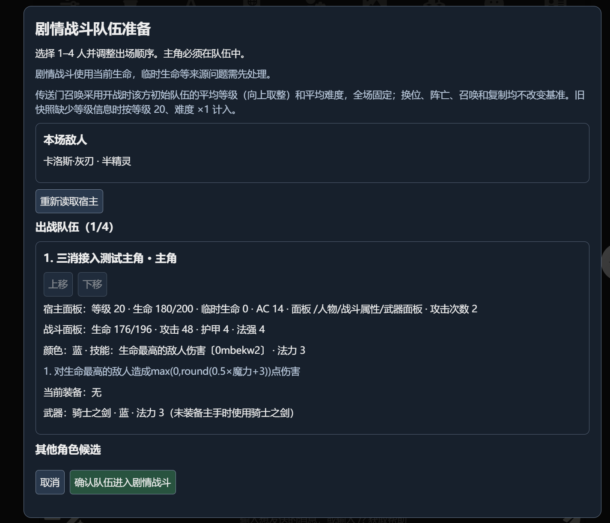
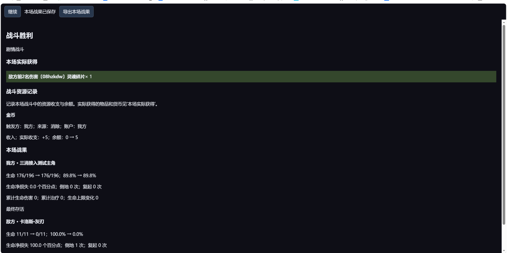
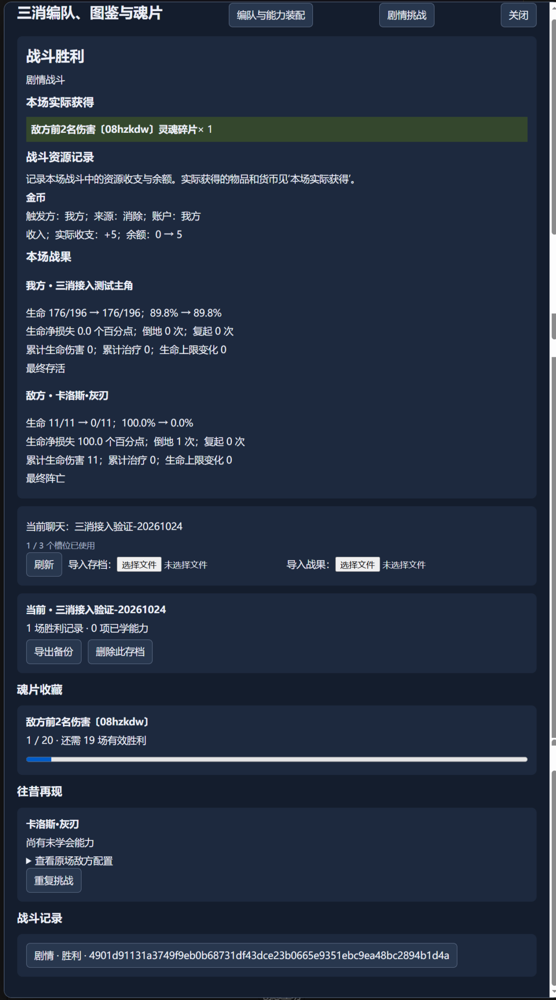
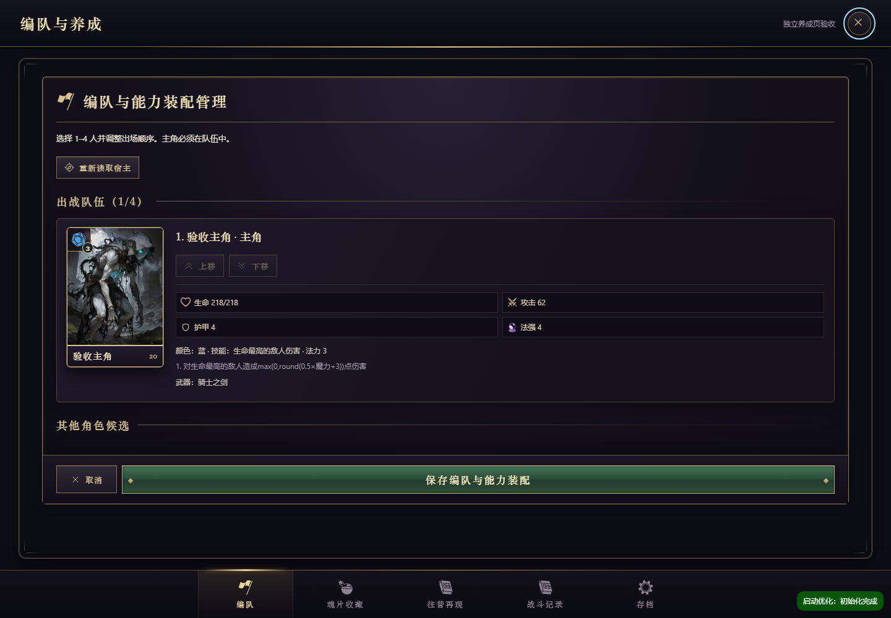
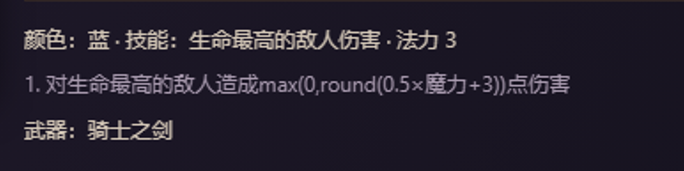

# 用户逐轮原话：完整会话归档

本文件逐条收录两个主会话及全部已找到续接段中的真实用户发言。正文保留原句、换行、重复提交和批评；未用需求摘要替代。时间统一显示为 UTC+8，原始 UTC 时间及逐条 SHA-256 见 [机器可读原文](user-turns.json)。用户截图从原日志图像附件原样提取，放在对应发言之后。

范围从最初清理项目的讨论起，直到本次交接请求。自动注入的 AGENTS／环境上下文、子 agent 通知、中断通知和自动续跑上下文另作数量统计，不列作用户聊天轮次。自动续跑中保存的两版用户目标另见 [目标补充记录](goal-context.md)。助手回答未混入用户原文。不同消息 ID 即使文字相同也保留；续接重发不擅自合并。

共 **95 条用户消息、8 个日志段、9 次截图附件（8 张独立原图）**。本文件记录本机这两条主会话中可恢复的全部用户消息，不代表全部项目历史会话。用户对失败结果的再次发言和续接重发也各占一条。

[交接正文](README.md) · [需求澄清与最终口径](decisions.md) · [文件说明](files.md) · [来源清单](sources.json)

## 发言索引

| 轮次 | 时间（UTC+8） | 原文开头 |
| --- | --- | --- |
| [U001](#u001) | 2026-10-19 00:46:15 | 看下这个项目，现在项目有一大堆无用文件和过时的设计文档或任务书，搞得乱七八糟的，想办法做一下检查，清理规整一下 |
| [U002](#u002) | 2026-10-19 01:08:06 | 技能审核的任务已经完成了，那些审查记录和相关任务书都可以直接删 |
| [U003](#u003) | 2026-10-19 01:32:23 | 我现在想在sillytavern中接入这个项目，可能不做云端服务器，只做游客模式的本地存档，玩家的存档信息就存到浏览器级别的本地数据库里 |
| [U004](#u004) | 2026-10-19 01:51:19 | 在开工前有几个东西要先做调研，首先就是养成体系，包括这个三消项目的武器淬炼、部队和敌人等级数值、相关养成素材的设置和获取，要怎么跟sillytavern里的体系做无缝替换衔接 |
| [U005](#u005) | 2026-10-19 02:09:38 | 你这调研调研了个啥东西啊？你到底看过现在这个三消项目的实际做法没有？ |
| [U006](#u006) | 2026-10-19 02:26:30 | 我怎么只看到你这个版本的调研写了一大堆不能不能不能，那到底怎么才能把两边联系起来？关键在于敌人的设计器，三消项目的敌人是绑定立绘的，需要给敌人展示立绘，但AI设计的敌人肯定是名称不 |
| [U007](#u007) | 2026-10-19 02:37:09 | 不是，你回答我你敌人职业、名称、种族、立绘是怎么让运行时AI挂钩设计的？ |
| [U008](#u008) | 2026-10-19 02:42:13 | 项目只需要找到一张符合“亡灵、人形、重甲、面具”的立绘。 |
| [U009](#u009) | 2026-10-19 02:50:05 | 还有一个问题啊，我想做的是一个通用战斗引擎，不因世界观发生定制。像西幻世界观与现有世界观类似，衔接起来不会有太大问题。但若是中式日式世界观，其实种族、职业、具体的立绘是完全对不上。 |
| [U010](#u010) | 2026-10-19 02:58:19 | 叙事文字你让运行时AI发有啥意义？叙事文字只留在运行时AI自己用啊，敌人组装器提供的应该是高度抽象化、职责化，跟世界观完全无关的字段 |
| [U011](#u011) | 2026-10-19 14:07:28 | 所以你给我从产品方向上具体设计一下实施方案 |
| [U012](#u012) | 2026-10-19 14:20:49 | 你这个默认使用抽象图形，不要求立绘匹配 |
| [U013](#u013) | 2026-10-19 14:38:20 | 你抽象也是有具有语义职责的抽象，可能是按照队伍职责、稀有度、剧情权重这些分类，分成什么杂兵、精英、传奇。人形、怪物这种通用大分类 |
| [U014](#u014) | 2026-10-19 14:52:05 | 不是，哪有什么群体啊 |
| [U015](#u015) | 2026-10-19 15:01:44 | \| 提示词中的明确描述                                   \| 可提取标签  \| |
| [U016](#u016) | 2026-10-19 15:08:09 | 形态分成这四种 |
| [U017](#u017) | 2026-10-19 15:12:47 | 形态分成这五种 |
| [U018](#u018) | 2026-10-19 15:31:28 | 写着兽族的角色，也可能只有兽耳和尾巴、面部仍是人脸。 |
| [U019](#u019) | 2026-10-19 22:32:51 | "unitRef": "e1", |
| [U020](#u020) | 2026-10-19 22:38:18 | D:\Code\match-3\docs\sillytavern-battle-product-plan.md |
| [U021](#u021) | 2026-10-19 22:44:41 | 没有实际意义你写进去干什么？ |
| [U022](#u022) | 2026-10-19 23:22:03 | 你把我最开始的原始需求，我的原话记录一下 |
| [U023](#u023) | 2026-10-19 23:35:45 | 后面还有后续的需求澄清啊 |
| [U024](#u024) | 2026-10-20 00:59:42 | 继续 |
| [U025](#u025) | 2026-10-20 01:13:15 | 那个产品任务书写完了吗下一步要做什么 |
| [U026](#u026) | 2026-10-20 01:39:00 | 你先照着刚才我的原始需求和需求澄清，起个上下文干净的子线程做审核，产品任务设计是否合理，能否实现我的需求 |
| [U027](#u027) | 2026-10-20 14:10:28 | “亡灵、重甲、面具”这类精确视觉要求是否纳入首版还没定清 |
| [U028](#u028) | 2026-10-20 14:17:09 | “亡灵、重甲、面具”这类精确视觉要求是否纳入首版还没定清 |
| [U029](#u029) | 2026-10-20 14:33:06 | “亡灵、重甲、面具”这类精确视觉要求是否纳入首版还没定清 |
| [U030](#u030) | 2026-10-20 14:58:44 | “亡灵、重甲、面具”这类精确视觉要求是否纳入首版还没定清 |
| [U031](#u031) | 2026-10-20 15:15:44 | 看下codex resume 01a14fe7-705b-7ff1-b24d-9192aa87fae5 继续任务 |
| [U032](#u032) | 2026-10-20 15:48:32 | 任务书覆盖到每一个具体设计了吗，不是代码层面的，是产品层面的，设计合理吗，对标成熟游戏做法 |
| [U033](#u033) | 2026-10-20 20:11:06 | sillytavern侧的AIRP是肯定不会让玩家重复去刷的，考虑在代码前端这侧，收集灵魂碎片的地方加一个往昔再现，重复挑战 |
| [U034](#u034) | 2026-10-20 20:31:06 | 其他还有问题吗 |
| [U035](#u035) | 2026-10-20 20:38:49 | 肯定是只有战胜才能进入图鉴。一场再现就是再现当时那场战斗的配置，跟稀有度有关，可能低稀有度得刷个二十来把才能刷齐，高稀有度刷个四五把之类的 |
| [U036](#u036) | 2026-10-20 21:07:10 | 逻辑全都通了吗完善了吗 |
| [U037](#u037) | 2026-10-20 21:10:56 | 不是三个三消槽位共享一份酒馆聊天，是一个槽位绑定一份酒馆聊天，如果要换酒馆聊天，需要重新创建存档，最多绑定三个聊天，再多需要玩家手动删除 |
| [U038](#u038) | 2026-10-20 21:13:20 | 不是三个三消槽位共享一份酒馆聊天，是一个槽位绑定一份酒馆聊天，如果要换酒馆聊天，需要重新创建存档，最多绑定三个聊天，再多需要玩家手动删除 |
| [U039](#u039) | 2026-10-20 21:21:36 | 其他还有问题吗 |
| [U040](#u040) | 2026-10-20 21:30:02 | 魂片收集暂时没有使用对象有啥影响？没有就没有呗，先收藏着啊这俩又没关系 |
| [U041](#u041) | 2026-10-20 21:35:43 | 还有问题吗 |
| [U042](#u042) | 2026-10-20 21:37:34 | 做推进计划吧 |
| [U043](#u043) | 2026-10-20 23:47:22 | 为什么是24~40个配方？敌人组装器要能组装出包含各个稀有度的至少90%以上的敌人才可以啊，那些有特殊机制，比如依赖晋升度、淘宝模式、魔头之类的技能不需要组装 |
| [U044](#u044) | 2026-10-21 17:20:53 | 执行吧 |
| [U045](#u045) | 2026-10-21 18:02:25 | 继续 |
| [U046](#u046) | 2026-10-21 18:37:44 | 继续 |
| [U047](#u047) | 2026-10-21 22:14:12 | 继续推进，推进后让子agent验收直到达成可交付人工测试 |
| [U048](#u048) | 2026-10-21 23:02:36 | 什么情况了 |
| [U049](#u049) | 2026-10-22 00:14:28 | D:\Code\match-3\tasks\active\STATUS.md |
| [U050](#u050) | 2026-10-23 00:42:27 | 为啥推进了这么久，8个小时了，step4，最关键的敌人组装器进度还是几乎为0？你是不是畏难？放着最关键也最难的部分不做？ |
| [U051](#u051) | 2026-10-23 01:05:05 | 不是你到底在干啥啊？怎么还在搞战斗内现在能区分我方／敌方金币和共享资源，并明确显示余额、上限及“结束不带出” |
| [U052](#u052) | 2026-10-24 00:10:41 | 现在是什么情况？你为啥还在做战斗基础引擎？这些东西为啥不能复用原本三消项目的？ |
| [U053](#u053) | 2026-10-24 00:17:37 | 继续吧 |
| [U054](#u054) | 2026-10-24 02:57:33 | 你这个效率太差了啊，敌人组装器进度到底咋样了？你一个个核对技能完全没意义啊，提供给酒馆运行时AI不可能让AI一个个手搓1800个敌人啊？你提供的敌人组装器肯定是用一套规则，分类组装 |
| [U055](#u055) | 2026-10-24 13:31:41 | 继续 |
| [U056](#u056) | 2026-10-24 14:23:03 | D:\Code\match-3\tasks\active\STATUS.md |
| [U057](#u057) | 2026-10-24 17:27:35 | 我在[http://127.0.0.1:8000/](http://127.0.0.1:8000/) |
| [U058](#u058) | 2026-10-24 17:27:43 | 我在http://127.0.0.1:8000/ |
| [U059](#u059) | 2026-10-24 21:09:32 | 运行时AI的协议呢？还有正则呢？ |
| [U060](#u060) | 2026-10-24 23:28:11 | 你写的这个运行时AI提示词写的太烂了，你写一大堆有啥用啊 |
| [U061](#u061) | 2026-10-24 23:45:56 | assembly：固定 "classified"。 |
| [U062](#u062) | 2026-10-24 23:49:16 | 1. 收到本场三消战果后才推进战后剧情。战果在 stat_data.三消战果 中，聊天镜像为 match3.storyResults；核对 battleId、requestId，采 |
| [U063](#u063) | 2026-10-24 23:58:55 | 1. 读取当前变量 stat_data.系统配置.三消战斗模式。仅 true 时适用；false、缺失或上下文未给出当前值时，沿用原生 AIRP 战斗规则。 |
| [U064](#u064) | 2026-10-25 00:07:28 | "version": 1, |
| [U065](#u065) | 2026-10-25 00:14:50 | 三消的难度和血量倍率是分开单独设置的 |
| [U066](#u066) | 2026-10-25 00:28:40 | 难度可能考虑要搞两种，普通和困难，然后都有动态难度，现在暂时不用管，现在先把基础的东西跑起来 |
| [U067](#u067) | 2026-10-25 00:44:20 | 需要程序自己浮动 |
| [U068](#u068) | 2026-10-25 00:49:52 | 护甲、魔力、攻击这些都是浮动的 |
| [U069](#u069) | 2026-10-25 01:07:53 | effects你没规定组合数量啊？你现在做的敌人组合器不会固定只能接受一种吧？ |
| [U070](#u070) | 2026-10-25 01:13:38 | 你能不能实际一点，怎么可能真的让填0~20个，那技能得有多长？ |
| [U071](#u071) | 2026-10-25 01:17:47 | 还有这些机制的权重肯定不是一样的啊，要结合role，而且大部分敌人都要有伤害键，你要去统计三消项目的真实技能分布是什么样的啊，然后写一个设计准则 |
| [U072](#u072) | 2026-10-25 01:18:48 | 还有这些机制的权重肯定不是一样的啊，要结合role，而且大部分敌人都要有伤害键，你要去统计三消项目的真实技能分布是什么样的啊，然后写一个设计准则 |
| [U073](#u073) | 2026-10-25 01:35:30 | 输出是 99.4%、法师是 100%， |
| [U074](#u074) | 2026-10-25 01:37:11 | 这不显然是要么你统计出问题了，要么你职责划分出问题了吗？大部分角色确实是需要输出技能，甚至标签是供魔的角色也可能是一边放技能输出一边转色，但这不意味着全把他们的职责标成输出和法师啊 |
| [U075](#u075) | 2026-10-25 15:28:28 | 要改敌人组装器，使其支持你现在这个敌人组装设计准则 |
| [U076](#u076) | 2026-10-25 16:26:35 | 你先按照你写的运行时AI的提示词，让子agent只看这个提示词，写几个战斗块出来，然后用现有的组装器组装模拟一下 |
| [U077](#u077) | 2026-10-25 16:46:36 | 修复 |
| [U078](#u078) | 2026-10-25 17:04:33 | 你这可用组合的方向就不对，立绘怎么可能是跟颜色绑定？ |
| [U079](#u079) | 2026-10-25 17:37:48 | 继续修组装器，还有让子agent盲审组装的时候也要对运行时AI的提示词提出意见，像块大小至多 32 KiB |
| [U080](#u080) | 2026-10-25 20:41:33 | [match3]这个改成&lt;match3&gt; |
| [U081](#u081) | 2026-10-25 21:11:42 | 姓名、种族也需要战斗块里提供，三消引擎渲染 |
| [U082](#u082) | 2026-10-25 21:53:06 | 你这个正则替换后的三消面板的代码，在酒馆助手环境下渲染不出东西 |
| [U083](#u083) | 2026-10-25 22:13:14 | 你这个界面实在太简陋了，你应该看下三消项目本体的战前加载页面，直接复用 |
| [U084](#u084) | 2026-10-25 22:29:16 | 你自己往上面画蛇添足加什么东西呢？布局还整错了 |
| [U085](#u085) | 2026-10-25 22:48:42 | 不都说了让你别他妈的画蛇添足写废话吗？什么即将开战，什么难度，什么结束后保存结果，你这不都是废话？ |
| [U086](#u086) | 2026-10-25 23:04:02 | 你这是啥东西啊我草？？为啥进入战斗还要再显示个这个面板，意义何在？ |
| [U087](#u087) | 2026-10-25 23:25:11 | 还有你这些东西，名字、种族、等级为啥要贴个片加上去？？这些东西不本来就是在详情里的吗？？详情不是套用三消战斗原有的那个就行了吗？这战斗后的东西也是，这是啥啊？？为啥不套用三消原本的 |
| [U088](#u088) | 2026-10-26 00:13:46 | 你这是啥啊？现在重新刷新渲染，直接跳出这个页面了 |
| [U089](#u089) | 2026-10-26 13:17:26 | 还有你这个页面不能作为独立页面使用，设计的太烂了，跟原本的三消项目完全不是一种风格，尽可能复用原本三消项目的页面和美术素材 |
| [U090](#u090) | 2026-10-26 15:55:44 | 你这做的是啥啊？不是跟你说了尽量复用三消的页面，不要再自己发明布局了，你看你这布局像样吗？ |
| [U091](#u091) | 2026-10-26 20:14:36 | 重新渲染后直接变成战斗胜利了，而且这个结算页面明显有问题 |
| [U092](#u092) | 2026-10-26 20:15:20 | 重新渲染后直接变成战斗胜利了，而且这个结算页面明显有问题 |
| [U093](#u093) | 2026-10-26 21:16:40 | 这个问题你就没看过吗？ |
| [U094](#u094) | 2026-10-26 21:19:11 | 战斗奖励的灵魂碎片肯定不能是这样啊，你乱写什么呢？ |
| [U095](#u095) | 2026-10-28 17:25:28 | 现在要把项目同步给其他人，需要写一个交接文档，详细记录我的原始需求，需求澄清的过程，直接把我从最开始每轮的对话都直接记录下来，然后也对后续其他文件做说明，最终要达到什么效果 |

<a id="u001"></a>
## U001 · 2026-10-19 00:46:15（UTC+8）

来源：`rollout-2026-10-19T00-45-30-01a14fe7-705b-7ff1-b24d-9192aa87fae5.jsonl.zst` 第 10 行；消息 ID：`msg_01a14fe8-2003-7990-a85a-2ae5c5d3832c`。

````text
看下这个项目，现在项目有一大堆无用文件和过时的设计文档或任务书，搞得乱七八糟的，想办法做一下检查，清理规整一下
````

<a id="u002"></a>
## U002 · 2026-10-19 01:08:06（UTC+8）

来源：`rollout-2026-10-19T00-45-30-01a14fe7-705b-7ff1-b24d-9192aa87fae5.jsonl.zst` 第 453 行；消息 ID：`msg_01a14ffc-2102-79e0-bd47-d079bd1d032c`。

````text
技能审核的任务已经完成了，那些审查记录和相关任务书都可以直接删
````

<a id="u003"></a>
## U003 · 2026-10-19 01:32:23（UTC+8）

来源：`rollout-2026-10-19T00-45-30-01a14fe7-705b-7ff1-b24d-9192aa87fae5.jsonl.zst` 第 727 行；消息 ID：`msg_01a15012-5f90-7002-a43f-9d8b1b55fdd4`。

````text
我现在想在sillytavern中接入这个项目，可能不做云端服务器，只做游客模式的本地存档，玩家的存档信息就存到浏览器级别的本地数据库里

主要用途是充当一个文字冒险跑团游戏的战斗部分，也就是说准备到要战斗的时候，sillytavern的运行时AI输出一个特定的格式，类似工具调用的用法，但是说输出到正文的中间，一小段模组文本，带有这场战斗的敌人信息
然后外部正则会匹配这个格式，用正则换进去远端网页链接，到时候以一个内嵌页面的形式出现在sillytavern，然后根据传入的参数启动战斗，战斗后把完整的战报过程发送反馈给sillytavern，让运行时AI根据战报演绎文字内容

你想一下这个过程合理不合理
````

<a id="u004"></a>
## U004 · 2026-10-19 01:51:19（UTC+8）

来源：`rollout-2026-10-19T00-45-30-01a14fe7-705b-7ff1-b24d-9192aa87fae5.jsonl.zst` 第 741 行；消息 ID：`msg_01a15023-b331-7e33-9d7b-38f9e86d460e`。

````text
在开工前有几个东西要先做调研，首先就是养成体系，包括这个三消项目的武器淬炼、部队和敌人等级数值、相关养成素材的设置和获取，要怎么跟sillytavern里的体系做无缝替换衔接

你可以看
D:\Code\match-3\docs\辅助计算脚本.js
D:\Code\match-3\docs\单次激活
D:\Code\match-3\docs\mvuzod.js

单次激活是sillytavern中的运行时AI能看到的提示词，最终所有的变量等内容都是作为提示词给运行时AI看的。另外俩js包含了现有sillytavern角色卡已有的变量和数值。最终希望是三消战斗和原生的类DND跑团战斗能无缝切换，所以数值希望能以sillytavern为准或者能以某种系数衔接挂钩

然后是玩家武器、部队和敌人部队在这种新模式下的设计。因为在文字冒险游戏中玩家不可能频繁换角色，所以是想做成类似恶魔城的灵魂碎片那种形式，你知道吧？就是打不同的怪会积累灵魂碎片进度，打够一定进度就解锁对应怪物的技能，玩家可以自由装配给同色的队友替换队友技能

这就衍生出另外几个问题。首先是这两千多种技能，以及现有项目的王国、种族、职业等固定写死的联动，怎么提供给sillytavern的AI用？我肯定不希望是固定绑定这一套世界观的，因此种族职业王国，敌人名称都不可能是固定的，要做一个通用引擎。那就可能要新搞一个项目做改造，但我又不想同时维护两个项目频繁更新同步进度。另外对于两千多种技能和七八百种主角武器的技能，可能要进行打标，得让运行时AI能通过一定的提示词SKILL，自己学会设计出合规的敌人，包含种族职业，以及他们拥有的技能。所以把两千多种技能全喂给AI是不现实的，得告诉他一些组合规则然后根据稀有度、等级、职业种族等信息实时设计

你在doc里拆解记录一下这些问题，然后分析一下后续方向


````

<a id="u005"></a>
## U005 · 2026-10-19 02:09:38（UTC+8）

来源：`rollout-2026-10-19T00-45-30-01a14fe7-705b-7ff1-b24d-9192aa87fae5.jsonl.zst` 第 904 行；消息 ID：`msg_01a15034-77bc-7062-ae37-a9d2dc4c6bff`。

````text
你这调研调研了个啥东西啊？你到底看过现在这个三消项目的实际做法没有？
D:\Code\match-3\docs\酒馆变量
这是实际的酒馆变量，什么技能树、资源技能、特质都是只服务于sillytavern AIRP的，跟三消项目是完全脱离的根本没法凑一块去

对于玩家的武器技能，只能用另外一套附加形式与原本的sillytavern AIRP联系起来，比如说辅助计算脚本里收到AI注册进来装备信息，就代码程序化随机附加一个武器技能和法力颜色进去之类的，或者在酒馆变量那侧只存一个武器代码，然后后面由其他前端根据武器代码展示对应技能和法力颜色以及萃取养成
````

<a id="u006"></a>
## U006 · 2026-10-19 02:26:30（UTC+8）

来源：`rollout-2026-10-19T00-45-30-01a14fe7-705b-7ff1-b24d-9192aa87fae5.jsonl.zst` 第 984 行；消息 ID：`msg_01a15043-eb3e-73c0-91ee-a859c8000e36`。

````text
我怎么只看到你这个版本的调研写了一大堆不能不能不能，那到底怎么才能把两边联系起来？关键在于敌人的设计器，三消项目的敌人是绑定立绘的，需要给敌人展示立绘，但AI设计的敌人肯定是名称不定，甚至职业、种族、技能也都不定的，那你到底怎么把这些东西对应起来？我一个字都没看你这个调研里说过，还有你的技能组合器能覆盖所有技能，合理生成所有敌人吗？需不需要重新对两千多个技能做打标归类，规范化和完整技能组合器？
````

<a id="u007"></a>
## U007 · 2026-10-19 02:37:09（UTC+8）

来源：`rollout-2026-10-19T00-45-30-01a14fe7-705b-7ff1-b24d-9192aa87fae5.jsonl.zst` 第 1160 行；消息 ID：`msg_01a1504d-ab02-7a61-84e0-f1d816daf768`。

````text
不是，你回答我你敌人职业、名称、种族、立绘是怎么让运行时AI挂钩设计的？
````

<a id="u008"></a>
## U008 · 2026-10-19 02:42:13（UTC+8）

来源：`rollout-2026-10-19T00-45-30-01a14fe7-705b-7ff1-b24d-9192aa87fae5.jsonl.zst` 第 1187 行；消息 ID：`msg_01a15052-4bdd-7c61-83e5-71959ba5a401`。

````text
项目只需要找到一张符合“亡灵、人形、重甲、面具”的立绘。

你这个就是假装可以实现实际坑非常大，你能不能先考虑下具体要怎么实现你这个只需要找到一张符合“亡灵、人形、重甲、面具”的过程？
````

<a id="u009"></a>
## U009 · 2026-10-19 02:50:05（UTC+8）

来源：`rollout-2026-10-19T00-45-30-01a14fe7-705b-7ff1-b24d-9192aa87fae5.jsonl.zst` 第 1292 行；消息 ID：`msg_01a15059-830c-7350-a04f-64db2afdc662`。

````text
还有一个问题啊，我想做的是一个通用战斗引擎，不因世界观发生定制。像西幻世界观与现有世界观类似，衔接起来不会有太大问题。但若是中式日式世界观，其实种族、职业、具体的立绘是完全对不上。三消这里对不上倒也算了，顶多拿近似标签或随机展示，但我不想因为给酒馆运行时的API看这些西幻的敌人标签，导致酒馆把敌人生成成西幻式的串味了
````

<a id="u010"></a>
## U010 · 2026-10-19 02:58:19（UTC+8）

来源：`rollout-2026-10-19T00-45-30-01a14fe7-705b-7ff1-b24d-9192aa87fae5.jsonl.zst` 第 1415 行；消息 ID：`msg_01a15061-09bd-7822-ad4e-d7f0d1d1a98c`。

````text
叙事文字你让运行时AI发有啥意义？叙事文字只留在运行时AI自己用啊，敌人组装器提供的应该是高度抽象化、职责化，跟世界观完全无关的字段
````

<a id="u011"></a>
## U011 · 2026-10-19 14:07:28（UTC+8）

来源：`rollout-2026-10-19T00-45-30-01a14fe7-705b-7ff1-b24d-9192aa87fae5.jsonl.zst` 第 1610 行；消息 ID：`msg_01a152c5-aa4b-7a43-8aa6-fde1beee1f6b`。

````text
所以你给我从产品方向上具体设计一下实施方案
````

<a id="u012"></a>
## U012 · 2026-10-19 14:20:49（UTC+8）

来源：`rollout-2026-10-19T00-45-30-01a14fe7-705b-7ff1-b24d-9192aa87fae5.jsonl.zst` 第 1727 行；消息 ID：`msg_01a152d1-e25d-7d71-90d3-0ce83708693a`。

````text
你这个默认使用抽象图形，不要求立绘匹配
一开始就错了，不能用抽象图形，需要想办法复用图片立绘资源，可能需要先设计敌人组装器，包括技能组装、种族的抽象、立绘的打标和组装
种族间的联动我认为是可以有的，但提供给运行时AI选用的是无具体含义的抽象种族代码之类的，或者你有其他更好的主意吗
````

<a id="u013"></a>
## U013 · 2026-10-19 14:38:20（UTC+8）

来源：`rollout-2026-10-19T00-45-30-01a14fe7-705b-7ff1-b24d-9192aa87fae5.jsonl.zst` 第 1933 行；消息 ID：`msg_01a152e1-ec43-7132-bf2a-1034dbe731e5`。

````text
你抽象也是有具有语义职责的抽象，可能是按照队伍职责、稀有度、剧情权重这些分类，分成什么杂兵、精英、传奇。人形、怪物这种通用大分类

你这全定成`R01 + M02 + V04`  ，运行时AI又不懂这些东西有什么区别，那不是跟全随机一个效果了吗
````

<a id="u014"></a>
## U014 · 2026-10-19 14:52:05（UTC+8）

来源：`rollout-2026-10-19T00-45-30-01a14fe7-705b-7ff1-b24d-9192aa87fae5.jsonl.zst` 第 2042 行；消息 ID：`msg_01a152ee-85b6-7071-9b86-5075862da328`。

````text
不是，哪有什么群体啊

D:\Code\dnf\comfyui_batch\立绘提示词汇总.txt

这是很久之前最初版的跑图提示词，先看看这个吧，用提示词打标应该比图片简单点
````

<a id="u015"></a>
## U015 · 2026-10-19 15:01:44（UTC+8）

来源：`rollout-2026-10-19T00-45-30-01a14fe7-705b-7ff1-b24d-9192aa87fae5.jsonl.zst` 第 2161 行；消息 ID：`msg_01a152f7-596d-7b52-80ca-de821e35301d`。

````text


| 提示词中的明确描述                                   | 可提取标签  |
| ------------------------------------------- | ------ |
| 火枪手：`long matchlock gun`、`wide-brimmed hat` | 火器、宽檐帽 |


你这不是在搞笑吗？我前面说的什么要求你都没看见？怎么还在提取火器、

| 宽檐帽<br><br> |
| ----------- |

````

<a id="u016"></a>
## U016 · 2026-10-19 15:08:09（UTC+8）

来源：`rollout-2026-10-19T00-45-30-01a14fe7-705b-7ff1-b24d-9192aa87fae5.jsonl.zst` 第 2213 行；消息 ID：`msg_01a152fd-3b4c-7ae2-9054-732616b6c3c6`。

````text
形态分成这四种
人形、野兽、类人、怪物
然后稀有度是分成
杂兵、精锐、首领、领主、传奇
稀有度主要根据三消项目定位，比如三消项目的神话对应传奇，史诗对应领主，传说对应首领 之类的
然后是队伍职责，这个三消项目自己就做了打标
供魔、法师、术士、坦克之类的

现在主要是对图片根据那四种形态打标
````

<a id="u017"></a>
## U017 · 2026-10-19 15:12:47（UTC+8）

来源：`rollout-2026-10-19T00-45-30-01a14fe7-705b-7ff1-b24d-9192aa87fae5.jsonl.zst` 第 2232 行；消息 ID：`msg_01a15301-76da-76c3-942a-6b1764ee3add`。

````text
形态分成这五种
人形、野兽、类人、怪物、异形体
然后稀有度是分成
杂兵、精锐、首领、领主、传奇
稀有度主要根据三消项目定位，比如三消项目的神话对应传奇，史诗对应领主，传说对应首领 之类的
然后是队伍职责，这个三消项目自己就做了打标
供魔、法师、术士、坦克之类的
现在主要是对图片根据那五种形态打标

并且立绘是也根据法力颜色挂钩的

法力颜色、稀有度、形态、队伍职责，共同确定一张立绘

到时候运行时AI就提供这几个维度。然后再考虑教会运行时AI设计敌人特质和技能


````

<a id="u018"></a>
## U018 · 2026-10-19 15:31:28（UTC+8）

来源：`rollout-2026-10-19T00-45-30-01a14fe7-705b-7ff1-b24d-9192aa87fae5.jsonl.zst` 第 2397 行；消息 ID：`msg_01a15312-92e0-73b1-8330-05cc67eb4565`。

````text
写着兽族的角色，也可能只有兽耳和尾巴、面部仍是人脸。
这种就是人形啊，类人是没有人脸的
````

<a id="u019"></a>
## U019 · 2026-10-19 22:32:51（UTC+8）

来源：`rollout-2026-10-19T00-45-30-01a14fe7-705b-7ff1-b24d-9192aa87fae5.jsonl.zst` 第 2828 行；消息 ID：`msg_01a15494-5c5c-7762-b7b5-1e137ac96f70`。

````text
  "unitRef": "e1",
  "blueprintRef": "new:01",

你这是什么
````

<a id="u020"></a>
## U020 · 2026-10-19 22:38:18（UTC+8）

来源：`rollout-2026-10-19T00-45-30-01a14fe7-705b-7ff1-b24d-9192aa87fae5.jsonl.zst` 第 2850 行；消息 ID：`msg_01a15499-5a37-7900-b72c-dac08ffab7d3`。

````text
D:\Code\match-3\docs\sillytavern-battle-product-plan.md
是这里的协议示例啊
````

<a id="u021"></a>
## U021 · 2026-10-19 22:44:41（UTC+8）

来源：`rollout-2026-10-19T00-45-30-01a14fe7-705b-7ff1-b24d-9192aa87fae5.jsonl.zst` 第 2883 行；消息 ID：`msg_01a1549f-322d-79f1-bfe7-a79f1c6f5a06`。

````text
没有实际意义你写进去干什么？
````

<a id="u022"></a>
## U022 · 2026-10-19 23:22:03（UTC+8）

来源：`rollout-2026-10-19T00-45-30-01a14fe7-705b-7ff1-b24d-9192aa87fae5.jsonl.zst` 第 2924 行；消息 ID：`msg_01a154c1-6777-7553-804c-1a3c9eef26d8`。

````text
你把我最开始的原始需求，我的原话记录一下
````

<a id="u023"></a>
## U023 · 2026-10-19 23:35:45（UTC+8）

来源：`rollout-2026-10-19T00-45-30-01a14fe7-705b-7ff1-b24d-9192aa87fae5.jsonl.zst` 第 2971 行；消息 ID：`msg_01a154cd-f173-7332-a464-c194c31060d7`。

````text
后面还有后续的需求澄清啊
````

<a id="u024"></a>
## U024 · 2026-10-20 00:59:42（UTC+8）

来源：`rollout-2026-10-19T00-45-30-01a14fe7-705b-7ff1-b24d-9192aa87fae5.jsonl.zst` 第 3013 行；消息 ID：`msg_01a1551a-cd83-7773-ae23-9fcc00220f74`。

````text
继续
````

<a id="u025"></a>
## U025 · 2026-10-20 01:13:15（UTC+8）

来源：`rollout-2026-10-19T00-45-30-01a14fe7-705b-7ff1-b24d-9192aa87fae5.jsonl.zst` 第 3045 行；消息 ID：`msg_01a15527-3631-7060-9038-7837afdaf9ab`。

````text
那个产品任务书写完了吗下一步要做什么
````

<a id="u026"></a>
## U026 · 2026-10-20 01:39:00（UTC+8）

来源：`rollout-2026-10-19T00-45-30-01a14fe7-705b-7ff1-b24d-9192aa87fae5.jsonl.zst` 第 3074 行；消息 ID：`msg_01a1553e-c8a9-70e3-9c33-3e4584eb5bf9`。

````text
你先照着刚才我的原始需求和需求澄清，起个上下文干净的子线程做审核，产品任务设计是否合理，能否实现我的需求
````

<a id="u027"></a>
## U027 · 2026-10-20 14:10:28（UTC+8）

来源：`rollout-2026-10-19T00-45-30-01a14fe7-705b-7ff1-b24d-9192aa87fae5.jsonl.zst` 第 3172 行；消息 ID：`msg_01a157ee-c710-7752-a614-8ea799e9ee5b`。

````text
“亡灵、重甲、面具”这类精确视觉要求是否纳入首版还没定清
这我的原始需求里不是已经说过不分这么细了吗
````

<a id="u028"></a>
## U028 · 2026-10-20 14:17:09（UTC+8）

来源：`rollout-2026-10-20T14-17-09-01a14fe7-705b-7ff1-b24d-9192aa87fae5_01a157f4-e443-7271-ab4f-b9186f4d590e.jsonl.zst` 第 10 行；消息 ID：`msg_01a157f4-e51f-7142-a8ec-bd80bc00acfd`。

````text
“亡灵、重甲、面具”这类精确视觉要求是否纳入首版还没定清
这我的原始需求里不是已经说过不分这么细了吗
````

<a id="u029"></a>
## U029 · 2026-10-20 14:33:06（UTC+8）

来源：`rollout-2026-10-20T14-33-06-01a14fe7-705b-7ff1-b24d-9192aa87fae5_01a15803-7d07-74a0-adb3-15b856f4bab3.jsonl.zst` 第 10 行；消息 ID：`msg_01a15803-7ddf-7631-9412-9e8c17f07b3d`。

````text
“亡灵、重甲、面具”这类精确视觉要求是否纳入首版还没定清
这我的原始需求里不是已经说过不分这么细了吗
````

<a id="u030"></a>
## U030 · 2026-10-20 14:58:44（UTC+8）

来源：`rollout-2026-10-20T14-58-44-01a14fe7-705b-7ff1-b24d-9192aa87fae5_01a1581a-f74a-7a00-8613-01cbe3549677.jsonl.zst` 第 10 行；消息 ID：`msg_01a1581a-f846-7972-96df-5f6636cdd841`。

````text
“亡灵、重甲、面具”这类精确视觉要求是否纳入首版还没定清
这我的原始需求里不是已经说过不分这么细了吗
````

<a id="u031"></a>
## U031 · 2026-10-20 15:15:44（UTC+8）

来源：`rollout-2026-10-20T15-15-40-01a1582a-76d5-7c82-a72d-0fd0ca1db893.jsonl` 第 8 行；消息 ID：`msg_01a1582a-85b3-7f51-ab13-122f8843aa70`。

````text
看下codex resume 01a14fe7-705b-7ff1-b24d-9192aa87fae5 继续任务
````

<a id="u032"></a>
## U032 · 2026-10-20 15:48:32（UTC+8）

来源：`rollout-2026-10-20T15-15-40-01a1582a-76d5-7c82-a72d-0fd0ca1db893.jsonl` 第 136 行；消息 ID：`msg_01a15848-8c8e-70d1-ac6f-f1d94e069000`。

````text
任务书覆盖到每一个具体设计了吗，不是代码层面的，是产品层面的，设计合理吗，对标成熟游戏做法
````

<a id="u033"></a>
## U033 · 2026-10-20 20:11:06（UTC+8）

来源：`rollout-2026-10-20T15-15-40-01a1582a-76d5-7c82-a72d-0fd0ca1db893.jsonl` 第 198 行；消息 ID：`msg_01a15938-f267-7302-bacf-5844f0167bea`。

````text
sillytavern侧的AIRP是肯定不会让玩家重复去刷的，考虑在代码前端这侧，收集灵魂碎片的地方加一个往昔再现，重复挑战
````

<a id="u034"></a>
## U034 · 2026-10-20 20:31:06（UTC+8）

来源：`rollout-2026-10-20T15-15-40-01a1582a-76d5-7c82-a72d-0fd0ca1db893.jsonl` 第 270 行；消息 ID：`msg_01a1594b-4050-7621-a484-96d31684cb57`。

````text
其他还有问题吗
````

<a id="u035"></a>
## U035 · 2026-10-20 20:38:49（UTC+8）

来源：`rollout-2026-10-20T15-15-40-01a1582a-76d5-7c82-a72d-0fd0ca1db893.jsonl` 第 297 行；消息 ID：`msg_01a15952-523f-7da2-8ebc-4fade8905a0a`。

````text
肯定是只有战胜才能进入图鉴。一场再现就是再现当时那场战斗的配置，跟稀有度有关，可能低稀有度得刷个二十来把才能刷齐，高稀有度刷个四五把之类的
学会能力就不允许重复刷取了，需要重复刷获取养成材料的话之后单独再加一个模式或者让玩家去AIRP的方式获取就行了，暂时先不考虑。图鉴就跟随酒馆聊天存档，开新档就切换，可能有几个存档槽位，然后存档绑定酒馆聊天级的变量之类的
````

<a id="u036"></a>
## U036 · 2026-10-20 21:07:10（UTC+8）

来源：`rollout-2026-10-20T15-15-40-01a1582a-76d5-7c82-a72d-0fd0ca1db893.jsonl` 第 442 行；消息 ID：`msg_01a1596c-45f1-7161-8286-59a97aa26f7b`。

````text
逻辑全都通了吗完善了吗
````

<a id="u037"></a>
## U037 · 2026-10-20 21:10:56（UTC+8）

来源：`rollout-2026-10-20T15-15-40-01a1582a-76d5-7c82-a72d-0fd0ca1db893.jsonl` 第 480 行；消息 ID：`msg_01a1596f-b768-7801-a283-dd558e3a7d44`。

````text
不是三个三消槽位共享一份酒馆聊天，是一个槽位绑定一份酒馆聊天，如果要换酒馆聊天，需要重新创建存档，最多绑定三个聊天，再多需要玩家手动删除
胜利就是三消的胜利啊，击败了哪几个敌人，自己这边哪些队友倒了，生命值受损多少百分比，都需要记录
不同来源出现相同能力就视为已经学会了
````

<a id="u038"></a>
## U038 · 2026-10-20 21:13:20（UTC+8）

来源：`rollout-2026-10-20T15-15-40-01a1582a-76d5-7c82-a72d-0fd0ca1db893.jsonl` 第 494 行；消息 ID：`msg_01a15971-ecef-7a53-8f39-baa9e0836679`。

````text
不是三个三消槽位共享一份酒馆聊天，是一个槽位绑定一份酒馆聊天，如果要换酒馆聊天，需要重新创建存档，最多绑定三个聊天，再多需要玩家手动删除
胜利就是三消的胜利啊，击败了哪几个敌人，自己这边哪些队友倒了，生命值受损多少百分比，都需要记录
不同来源出现相同能力就视为已经学会了
````

<a id="u039"></a>
## U039 · 2026-10-20 21:21:36（UTC+8）

来源：`rollout-2026-10-20T15-15-40-01a1582a-76d5-7c82-a72d-0fd0ca1db893.jsonl` 第 570 行；消息 ID：`msg_01a15979-7e5a-72c3-a859-15329c86a435`。

````text
其他还有问题吗
````

<a id="u040"></a>
## U040 · 2026-10-20 21:30:02（UTC+8）

来源：`rollout-2026-10-20T15-15-40-01a1582a-76d5-7c82-a72d-0fd0ca1db893.jsonl` 第 646 行；消息 ID：`msg_01a15981-3702-7c52-9966-09893f860289`。

````text
魂片收集暂时没有使用对象有啥影响？没有就没有呗，先收藏着啊这俩又没关系
同伴的颜色也是写到酒馆侧的变量里落地的
主角没有武器的情况，你就随便从现在三消武器里挑一个稀有度最低的武器当默认武器就行了
````

<a id="u041"></a>
## U041 · 2026-10-20 21:35:43（UTC+8）

来源：`rollout-2026-10-20T15-15-40-01a1582a-76d5-7c82-a72d-0fd0ca1db893.jsonl` 第 708 行；消息 ID：`msg_01a15986-6ad6-7e50-a24b-fc5e2a94a850`。

````text
还有问题吗
````

<a id="u042"></a>
## U042 · 2026-10-20 21:37:34（UTC+8）

来源：`rollout-2026-10-20T15-15-40-01a1582a-76d5-7c82-a72d-0fd0ca1db893.jsonl` 第 727 行；消息 ID：`msg_01a15988-1c25-7d50-a40a-48434c4b8e7b`。

````text
做推进计划吧
````

<a id="u043"></a>
## U043 · 2026-10-20 23:47:22（UTC+8）

来源：`rollout-2026-10-20T15-15-40-01a1582a-76d5-7c82-a72d-0fd0ca1db893.jsonl` 第 791 行；消息 ID：`msg_01a159fe-f238-7da0-ab8e-1f54bfcb69e2`。

````text
为什么是24~40个配方？敌人组装器要能组装出包含各个稀有度的至少90%以上的敌人才可以啊，那些有特殊机制，比如依赖晋升度、淘宝模式、魔头之类的技能不需要组装
````

<a id="u044"></a>
## U044 · 2026-10-21 17:20:53（UTC+8）

来源：`rollout-2026-10-20T15-15-40-01a1582a-76d5-7c82-a72d-0fd0ca1db893.jsonl` 第 848 行；消息 ID：`msg_01a15dc3-757f-7ff1-bb46-9b46e01f1ae0`。

````text
执行吧
````

<a id="u045"></a>
## U045 · 2026-10-21 18:02:25（UTC+8）

来源：`rollout-2026-10-20T15-15-40-01a1582a-76d5-7c82-a72d-0fd0ca1db893.jsonl` 第 877 行；消息 ID：`msg_01a15de9-7e35-7ba2-88b7-9e8366ddc3f4`。

````text
继续
````

<a id="u046"></a>
## U046 · 2026-10-21 18:37:44（UTC+8）

来源：`rollout-2026-10-20T15-15-40-01a1582a-76d5-7c82-a72d-0fd0ca1db893.jsonl` 第 970 行；消息 ID：`msg_01a15e09-d27f-7ce1-add0-a9e25b57cd4b`。

````text
继续
````

<a id="u047"></a>
## U047 · 2026-10-21 22:14:12（UTC+8）

来源：`rollout-2026-10-20T15-15-40-01a1582a-76d5-7c82-a72d-0fd0ca1db893.jsonl` 第 2244 行；消息 ID：`msg_01a15ed0-0021-7d91-9a39-a7078eb58a70`。

````text
继续推进，推进后让子agent验收直到达成可交付人工测试
````

<a id="u048"></a>
## U048 · 2026-10-21 23:02:36（UTC+8）

来源：`rollout-2026-10-20T15-15-40-01a1582a-76d5-7c82-a72d-0fd0ca1db893.jsonl` 第 2530 行；消息 ID：`msg_01a15efc-501c-77a1-b93d-d69a2341c1d4`。

````text
什么情况了
````

<a id="u049"></a>
## U049 · 2026-10-22 00:14:28（UTC+8）

来源：`rollout-2026-10-20T15-15-40-01a1582a-76d5-7c82-a72d-0fd0ca1db893.jsonl` 第 3396 行；消息 ID：`msg_01a15f3e-1b0f-70f0-a663-2a62aafc550b`。

````text
D:\Code\match-3\tasks\active\STATUS.md
这里的执行状态呢
````

<a id="u050"></a>
## U050 · 2026-10-23 00:42:27（UTC+8）

来源：`rollout-2026-10-20T15-15-40-01a1582a-76d5-7c82-a72d-0fd0ca1db893.jsonl` 第 10368 行；消息 ID：`msg_01a1647e-1808-79c2-bd07-5d5aa818acc4`。

````text
为啥推进了这么久，8个小时了，step4，最关键的敌人组装器进度还是几乎为0？你是不是畏难？放着最关键也最难的部分不做？
````

<a id="u051"></a>
## U051 · 2026-10-23 01:05:05（UTC+8）

来源：`rollout-2026-10-20T15-15-40-01a1582a-76d5-7c82-a72d-0fd0ca1db893.jsonl` 第 10754 行；消息 ID：`msg_01a16492-d100-7513-a328-222c47892a70`。

````text
不是你到底在干啥啊？怎么还在搞战斗内现在能区分我方／敌方金币和共享资源，并明确显示余额、上限及“结束不带出”

这些东西不都是三消项目原来就有的逻辑吗？你不会在重复造轮子吧？
````

<a id="u052"></a>
## U052 · 2026-10-24 00:10:41（UTC+8）

来源：`rollout-2026-10-20T15-15-40-01a1582a-76d5-7c82-a72d-0fd0ca1db893.jsonl` 第 18858 行；消息 ID：`msg_01a16987-5e96-7b61-8bda-877a426e1d43`。

````text
现在是什么情况？你为啥还在做战斗基础引擎？这些东西为啥不能复用原本三消项目的？
````

<a id="u053"></a>
## U053 · 2026-10-24 00:17:37（UTC+8）

来源：`rollout-2026-10-20T15-15-40-01a1582a-76d5-7c82-a72d-0fd0ca1db893.jsonl` 第 18914 行；消息 ID：`msg_01a1698d-b7ac-7df2-b4da-f6b3f877de61`。

````text
继续吧
````

<a id="u054"></a>
## U054 · 2026-10-24 02:57:33（UTC+8）

来源：`rollout-2026-10-20T15-15-40-01a1582a-76d5-7c82-a72d-0fd0ca1db893.jsonl` 第 22147 行；消息 ID：`msg_01a16a20-2244-77b3-ac02-703ca069e010`。

````text
你这个效率太差了啊，敌人组装器进度到底咋样了？你一个个核对技能完全没意义啊，提供给酒馆运行时AI不可能让AI一个个手搓1800个敌人啊？你提供的敌人组装器肯定是用一套规则，分类组装的啊，把技能、特质分类组装，再分类验证，你一项项验证完全无意义
````

<a id="u055"></a>
## U055 · 2026-10-24 13:31:41（UTC+8）

来源：`rollout-2026-10-20T15-15-40-01a1582a-76d5-7c82-a72d-0fd0ca1db893.jsonl` 第 22653 行；消息 ID：`msg_01a16c64-b317-7d80-8239-392da1618d8c`。

````text
继续
````

<a id="u056"></a>
## U056 · 2026-10-24 14:23:03（UTC+8）

来源：`rollout-2026-10-20T15-15-40-01a1582a-76d5-7c82-a72d-0fd0ca1db893.jsonl` 第 23673 行；消息 ID：`msg_01a16c93-bd0c-7d83-a0e6-b0832ed3843e`。

````text
D:\Code\match-3\tasks\active\STATUS.md
我看你这
ST-04之后的都还在进行中啊
还有你做浏览器测试了吗？酒馆环境是一个嵌入页面，把这个单独的三消引擎部署到网页后，由酒馆助手嵌入渲染，或者支持全屏打开，相关链路打通了吗？
交付人工测试是要到真实酒馆联调的，也就是到发布部署网页之后了
````

<a id="u057"></a>
## U057 · 2026-10-24 17:27:35（UTC+8）

来源：`rollout-2026-10-20T15-15-40-01a1582a-76d5-7c82-a72d-0fd0ca1db893.jsonl` 第 25013 行；消息 ID：`msg_01a16d3c-ae3b-73f3-8614-d44cd9071c69`。

````text
我在[http://127.0.0.1:8000/](http://127.0.0.1:8000/)
起了个酒馆项目，你能直接操作浏览器吗？
实际上存档创建不应该作为一个单独的酒馆助手脚本存在，我有独立的开局配置页面
D:\Code\dnf\code\开局.html

这个特殊的三消战斗模式是独立可开关的，它作为一个MVU的变量配置，类似世界观的变量那样存储到MVU变量的系统配置那里，可供切换
实际游玩过程中，可能要像
D:\Code\dnf\code\外置状态栏.js 一样

D:\Code\dnf\code\底部状态栏.html
在底部状态栏考虑找一个地方，把编队养成图鉴等面板，像外置状态栏一样做出一个单独的js注入的html网页，可以通过底部状态栏唤起

然后现在的战斗相关协议呢？这块是怎么对标我的原始
````

<a id="u058"></a>
## U058 · 2026-10-24 17:27:43（UTC+8）

来源：`rollout-2026-10-24T17-27-43-01a1582a-76d5-7c82-a72d-0fd0ca1db893_01a16d3c-cac2-70e2-bd02-bd727f99d9a4.jsonl` 第 8 行；消息 ID：`msg_01a16d3c-cb98-7f31-8c98-988d7c2f661e`。

````text
我在http://127.0.0.1:8000/
起了个酒馆项目，你能直接操作浏览器吗？
实际上存档创建不应该作为一个单独的酒馆助手脚本存在，我有独立的开局配置页面
D:\Code\dnf\code\开局.html

这个特殊的三消战斗模式是独立可开关的，它作为一个MVU的变量配置，类似世界观的变量那样存储到MVU变量的系统配置那里，可供切换
实际游玩过程中，可能要像
D:\Code\dnf\code\外置状态栏.js 一样

D:\Code\dnf\code\底部状态栏.html
在底部状态栏考虑找一个地方，把编队养成图鉴等面板，像外置状态栏一样做出一个单独的js注入的html网页，可以通过底部状态栏唤起

然后现在的战斗相关协议呢？这块是怎么对标我的原始需求？
````

<a id="u059"></a>
## U059 · 2026-10-24 21:09:32（UTC+8）

来源：`rollout-2026-10-24T17-27-43-01a1582a-76d5-7c82-a72d-0fd0ca1db893_01a16d3c-cac2-70e2-bd02-bd727f99d9a4.jsonl` 第 1169 行；消息 ID：`msg_01a16e07-e036-7c93-a2a2-3645a51aff87`。

````text
运行时AI的协议呢？还有正则呢？
````

<a id="u060"></a>
## U060 · 2026-10-24 23:28:11（UTC+8）

来源：`rollout-2026-10-24T17-27-43-01a1582a-76d5-7c82-a72d-0fd0ca1db893_01a16d3c-cac2-70e2-bd02-bd727f99d9a4.jsonl` 第 2241 行；消息 ID：`msg_01a16e86-cf13-7890-9a45-31e705b7de7f`。

````text
你写的这个运行时AI提示词写的太烂了，你写一大堆有啥用啊

效果依据实际主动与特质判定，不从源标签推测；条件、概率、分支与目标仍由实际配方决定，声明机制不保证每次触发，分支独有效果不算确定能力。完整随机和条件机制保留。

这些东西有啥用？
而且你这个提示词根本没讲清楚是让运行时AI什么时候做什么事

D:\Code\match-3\docs\战斗规则.md

这个战斗规则是另外的AIRP模式的提示词，参考一下，要任务清晰，有条理的写
````

<a id="u061"></a>
## U061 · 2026-10-24 23:45:56（UTC+8）

来源：`rollout-2026-10-24T17-27-43-01a1582a-76d5-7c82-a72d-0fd0ca1db893_01a16d3c-cac2-70e2-bd02-bd727f99d9a4.jsonl` 第 2471 行；消息 ID：`msg_01a16e97-1219-73b1-add5-9ed5b00e39c6`。

````text
assembly：固定 "classified"。

这个既然是固定你还让AI写什么？
````

<a id="u062"></a>
## U062 · 2026-10-24 23:49:16（UTC+8）

来源：`rollout-2026-10-24T17-27-43-01a1582a-76d5-7c82-a72d-0fd0ca1db893_01a16d3c-cac2-70e2-bd02-bd727f99d9a4.jsonl` 第 2564 行；消息 ID：`msg_01a16e9a-1e0b-7860-8a85-33a6efa5c694`。

````text
1. 收到本场三消战果后才推进战后剧情。战果在 stat_data.三消战果 中，聊天镜像为 match3.storyResults；核对 battleId、requestId，采用对应本次遭遇的记录，历史记录不当作新结果。
2. 按真实胜负、击败的敌人、我方倒下与复起情况、生命百分比变化描述后果。只有战况摘要时就写战后场景；有完整行动记录时再据此演绎交锋过程。
3. 生命变化已由程序回写，叙事按现有 HP 描述伤势；HP 是体力与防御余裕的综合，仍有 HP 的角色保留行动可能。奖励只引用本场实际结算收据中的真实名称与数量，已入账内容不重复发放；缺少奖励记录时先续写已确认战况。
4. 尚未收到本场战果时继续等待，别用玩家一句“继续”推断战斗已结束。往昔再现在前端挑战和结算，无需重新演一遍 AIRP 遭遇，也不推进新的剧情战果。


还有这些东西。这跟运行时AI有啥关系啊？运行时AI核对battleId、requestId，采用对应本次遭遇的记录，历史记录不当作新结果。干什么？
运行时AI只负责接收战斗结束后的战报啊
````

<a id="u063"></a>
## U063 · 2026-10-24 23:58:55（UTC+8）

来源：`rollout-2026-10-24T17-27-43-01a1582a-76d5-7c82-a72d-0fd0ca1db893_01a16d3c-cac2-70e2-bd02-bd727f99d9a4.jsonl` 第 2654 行；消息 ID：`msg_01a16ea2-f39d-7be0-a862-63873dfd0b5e`。

````text
1. 读取当前变量 stat_data.系统配置.三消战斗模式。仅 true 时适用；false、缺失或上下文未给出当前值时，沿用原生 AIRP 战斗规则。
2. 玩家决定交战，或敌方已发动必须应对的攻击时，进入战前准备。仅发现敌人、对峙、交涉或尚在潜行时，继续当前剧情，暂不生成战斗块。
3. 玩家明确选择原生 AIRP 处理本次战斗时，使用原规则。一旦本场已交给三消，就等待三消结算，同一场只采用一套战果。

你这个不是搞笑的吗，运行时AI又看不到那个变量，你要用EJS写出来自己控制啊，类似D:\Code\match-3\docs\战斗规则.md 的
有任何问题你先问，不要自己写一些似是而非想当然的东西
````

<a id="u064"></a>
## U064 · 2026-10-25 00:07:28（UTC+8）

来源：`rollout-2026-10-24T17-27-43-01a1582a-76d5-7c82-a72d-0fd0ca1db893_01a16d3c-cac2-70e2-bd02-bd727f99d9a4.jsonl` 第 2771 行；消息 ID：`msg_01a16eaa-c7d1-7f90-b4a5-23b17167f18b`。

````text
  "version": 1,
  "difficulty": "普通",
      "storyWeight": 1
      "difficulty": 1,
这又是啥？全局难度在别的地方设置啊，运行时AI要这么多维度干什么？还有          "requirement": "required"
又是啥
````

<a id="u065"></a>
## U065 · 2026-10-25 00:14:50（UTC+8）

来源：`rollout-2026-10-24T17-27-43-01a1582a-76d5-7c82-a72d-0fd0ca1db893_01a16d3c-cac2-70e2-bd02-bd727f99d9a4.jsonl` 第 2862 行；消息 ID：`msg_01a16eb1-8574-7932-9251-e46964ba4865`。

````text
三消的难度和血量倍率是分开单独设置的
````

<a id="u066"></a>
## U066 · 2026-10-25 00:28:40（UTC+8）

来源：`rollout-2026-10-24T17-27-43-01a1582a-76d5-7c82-a72d-0fd0ca1db893_01a16d3c-cac2-70e2-bd02-bd727f99d9a4.jsonl` 第 2918 行；消息 ID：`msg_01a16ebe-31e8-7351-bc21-d4c113f6fba4`。

````text
难度可能考虑要搞两种，普通和困难，然后都有动态难度，现在暂时不用管，现在先把基础的东西跑起来
````

<a id="u067"></a>
## U067 · 2026-10-25 00:44:20（UTC+8）

来源：`rollout-2026-10-24T17-27-43-01a1582a-76d5-7c82-a72d-0fd0ca1db893_01a16d3c-cac2-70e2-bd02-bd727f99d9a4.jsonl` 第 3234 行；消息 ID：`msg_01a16ecc-8910-7ca3-b99f-2ddd0ceaa9db`。

````text
需要程序自己浮动
````

<a id="u068"></a>
## U068 · 2026-10-25 00:49:52（UTC+8）

来源：`rollout-2026-10-24T17-27-43-01a1582a-76d5-7c82-a72d-0fd0ca1db893_01a16d3c-cac2-70e2-bd02-bd727f99d9a4.jsonl` 第 3362 行；消息 ID：`msg_01a16ed1-983f-7893-9b46-e9f581839a8c`。

````text
护甲、魔力、攻击这些都是浮动的
````

<a id="u069"></a>
## U069 · 2026-10-25 01:07:53（UTC+8）

来源：`rollout-2026-10-24T17-27-43-01a1582a-76d5-7c82-a72d-0fd0ca1db893_01a16d3c-cac2-70e2-bd02-bd727f99d9a4.jsonl` 第 3786 行；消息 ID：`msg_01a16ee2-18c2-7631-b31a-51d16165812d`。

````text
effects你没规定组合数量啊？你现在做的敌人组合器不会固定只能接受一种吧？
````

<a id="u070"></a>
## U070 · 2026-10-25 01:13:38（UTC+8）

来源：`rollout-2026-10-24T17-27-43-01a1582a-76d5-7c82-a72d-0fd0ca1db893_01a16d3c-cac2-70e2-bd02-bd727f99d9a4.jsonl` 第 3914 行；消息 ID：`msg_01a16ee7-5a36-7911-aa5c-a43426e54e24`。

````text
你能不能实际一点，怎么可能真的让填0~20个，那技能得有多长？
````

<a id="u071"></a>
## U071 · 2026-10-25 01:17:47（UTC+8）

来源：`rollout-2026-10-24T17-27-43-01a1582a-76d5-7c82-a72d-0fd0ca1db893_01a16d3c-cac2-70e2-bd02-bd727f99d9a4.jsonl` 第 3922 行；消息 ID：`msg_01a16eeb-2705-7090-8ab4-afced46a5ea9`。

````text
还有这些机制的权重肯定不是一样的啊，要结合role，而且大部分敌人都要有伤害键，你要去统计三消项目的真实技能分布是什么样的啊，然后写一个设计准则
肯定不能让杂兵人人带四五个机制的技能还有吞噬、额外回合这种强力效果啊？
还有伤害效果又不指一种，有单体、群攻、溅射、散射，你怎么就只有一个伤害？
还有爆破效果，爆破多少个宝石？爆破什么宝石？还有召唤、变形，召唤什么？变形什么？
还有造石、供魔、转色，造什么？供什么？转什么？
你这些东西都完全没考虑啊，太简陋了根本落地不下去

````

<a id="u072"></a>
## U072 · 2026-10-25 01:18:48（UTC+8）

来源：`rollout-2026-10-25T01-18-48-01a1582a-76d5-7c82-a72d-0fd0ca1db893_01a16eec-167f-7ba1-82c9-4aa761e47ce7.jsonl` 第 8 行；消息 ID：`msg_01a16eec-176e-72b2-85e3-66e02628f80c`。

````text
还有这些机制的权重肯定不是一样的啊，要结合role，而且大部分敌人都要有伤害键，你要去统计三消项目的真实技能分布是什么样的啊，然后写一个设计准则
肯定不能让杂兵人人带四五个机制的技能还有吞噬、额外回合这种强力效果啊？
还有伤害效果又不指一种，有单体、群攻、溅射、散射，你怎么就只有一个伤害？
还有爆破效果，爆破多少个宝石？爆破什么宝石？还有召唤、变形，召唤什么？变形什么？
还有造石、供魔、转色，造什么？供什么？转什么？
伤害的倍率是什么样的？三消项目根据稀有度和技能费用，有不同的魔力倍率，不同的技能基础数值，还有根据血量或护甲加成的技能
你这些东西都完全没考虑啊，太简陋了根本落地不下去
````

<a id="u073"></a>
## U073 · 2026-10-25 01:35:30（UTC+8）

来源：`rollout-2026-10-25T01-18-48-01a1582a-76d5-7c82-a72d-0fd0ca1db893_01a16eec-167f-7ba1-82c9-4aa761e47ce7.jsonl` 第 242 行；消息 ID：`msg_01a16efb-60ec-7ba3-a339-f97c71e58c3d`。

````text
输出是 99.4%、法师是 100%，

这个指标写出来你自己就不觉得奇怪吗
````

<a id="u074"></a>
## U074 · 2026-10-25 01:37:11（UTC+8）

来源：`rollout-2026-10-25T01-18-48-01a1582a-76d5-7c82-a72d-0fd0ca1db893_01a16eec-167f-7ba1-82c9-4aa761e47ce7.jsonl` 第 258 行；消息 ID：`msg_01a16efc-ecec-7d51-98a5-867909e60000`。

````text
这不显然是要么你统计出问题了，要么你职责划分出问题了吗？大部分角色确实是需要输出技能，甚至标签是供魔的角色也可能是一边放技能输出一边转色，但这不意味着全把他们的职责标成输出和法师啊
````

<a id="u075"></a>
## U075 · 2026-10-25 15:28:28（UTC+8）

来源：`rollout-2026-10-25T01-18-48-01a1582a-76d5-7c82-a72d-0fd0ca1db893_01a16eec-167f-7ba1-82c9-4aa761e47ce7.jsonl` 第 506 行；消息 ID：`msg_01a171f5-fa54-7b72-9731-25c815d316ed`。

````text
要改敌人组装器，使其支持你现在这个敌人组装设计准则

到时候面向运行时AI，运行时AI可能只选role，具体的effects不要成为运行时AI设计的负担，由敌人组装器按权重随机组合效果
````

<a id="u076"></a>
## U076 · 2026-10-25 16:26:35（UTC+8）

来源：`rollout-2026-10-25T01-18-48-01a1582a-76d5-7c82-a72d-0fd0ca1db893_01a16eec-167f-7ba1-82c9-4aa761e47ce7.jsonl` 第 1725 行；消息 ID：`msg_01a1722b-2f2c-7f10-9cf9-357a5586e492`。

````text
你先按照你写的运行时AI的提示词，让子agent只看这个提示词，写几个战斗块出来，然后用现有的组装器组装模拟一下
````

<a id="u077"></a>
## U077 · 2026-10-25 16:46:36（UTC+8）

来源：`rollout-2026-10-25T01-18-48-01a1582a-76d5-7c82-a72d-0fd0ca1db893_01a16eec-167f-7ba1-82c9-4aa761e47ce7.jsonl` 第 2008 行；消息 ID：`msg_01a1723d-821e-7cd3-b29f-b28f18fe2df7`。

````text
修复
````

<a id="u078"></a>
## U078 · 2026-10-25 17:04:33（UTC+8）

来源：`rollout-2026-10-25T01-18-48-01a1582a-76d5-7c82-a72d-0fd0ca1db893_01a16eec-167f-7ba1-82c9-4aa761e47ce7.jsonl` 第 2406 行；消息 ID：`msg_01a1724d-f235-7850-9e7f-4d596b31e4b3`。

````text
你这可用组合的方向就不对，立绘怎么可能是跟颜色绑定？
````

<a id="u079"></a>
## U079 · 2026-10-25 17:37:48（UTC+8）

来源：`rollout-2026-10-25T01-18-48-01a1582a-76d5-7c82-a72d-0fd0ca1db893_01a16eec-167f-7ba1-82c9-4aa761e47ce7.jsonl` 第 3057 行；消息 ID：`msg_01a1726c-64f3-7832-ae10-dffcd4bfcae8`。

````text
继续修组装器，还有让子agent盲审组装的时候也要对运行时AI的提示词提出意见，像块大小至多 32 KiB
这种完全无用的东西就应该审出来，你给运行时提示词说块大小32kb有啥意义？运行时AI又不可能真写这么多
````

<a id="u080"></a>
## U080 · 2026-10-25 20:41:33（UTC+8）

来源：`rollout-2026-10-25T01-18-48-01a1582a-76d5-7c82-a72d-0fd0ca1db893_01a16eec-167f-7ba1-82c9-4aa761e47ce7.jsonl` 第 4201 行；消息 ID：`msg_01a17314-9cf2-76b1-bd77-4caa2ec366ad`。

````text
[match3]这个改成<match3>
正则也要改，然后说明一下需要交付人工部署的文件和正则
````

<a id="u081"></a>
## U081 · 2026-10-25 21:11:42（UTC+8）

来源：`rollout-2026-10-25T01-18-48-01a1582a-76d5-7c82-a72d-0fd0ca1db893_01a16eec-167f-7ba1-82c9-4aa761e47ce7.jsonl` 第 4440 行；消息 ID：`msg_01a17330-3999-7101-a3f1-cda0e436ce48`。

````text
姓名、种族也需要战斗块里提供，三消引擎渲染
````

<a id="u082"></a>
## U082 · 2026-10-25 21:53:06（UTC+8）

来源：`rollout-2026-10-25T01-18-48-01a1582a-76d5-7c82-a72d-0fd0ca1db893_01a16eec-167f-7ba1-82c9-4aa761e47ce7.jsonl` 第 4801 行；消息 ID：`msg_01a17356-20a1-7e43-b63c-fb7c04a21be4`。

````text
你这个正则替换后的三消面板的代码，在酒馆助手环境下渲染不出东西
````

<a id="u083"></a>
## U083 · 2026-10-25 22:13:14（UTC+8）

来源：`rollout-2026-10-25T01-18-48-01a1582a-76d5-7c82-a72d-0fd0ca1db893_01a16eec-167f-7ba1-82c9-4aa761e47ce7.jsonl` 第 5110 行；消息 ID：`msg_01a17368-8dc1-7530-b5b5-09c2486945a0`。

````text
你这个界面实在太简陋了，你应该看下三消项目本体的战前加载页面，直接复用
````

<a id="u084"></a>
## U084 · 2026-10-25 22:29:16（UTC+8）

来源：`rollout-2026-10-25T01-18-48-01a1582a-76d5-7c82-a72d-0fd0ca1db893_01a16eec-167f-7ba1-82c9-4aa761e47ce7.jsonl` 第 5372 行；消息 ID：`msg_01a17377-3d9b-7be3-841b-3e26c5dc89ed`。

````text
你自己往上面画蛇添足加什么东西呢？布局还整错了
剧情三消战斗这是个啥东西？返回存档又是啥？为啥要在这里返回存档？至于全屏，三消项目不是自带一个全屏按钮吗？你为什么又要做一遍？
````

<a id="u085"></a>
## U085 · 2026-10-25 22:48:42（UTC+8）

来源：`rollout-2026-10-25T01-18-48-01a1582a-76d5-7c82-a72d-0fd0ca1db893_01a16eec-167f-7ba1-82c9-4aa761e47ce7.jsonl` 第 5697 行；消息 ID：`msg_01a17389-0647-7832-9a0d-fbb8e607cfca`。

````text
不都说了让你别他妈的画蛇添足写废话吗？什么即将开战，什么难度，什么结束后保存结果，你这不都是废话？
````

<a id="u086"></a>
## U086 · 2026-10-25 23:04:02（UTC+8）

来源：`rollout-2026-10-25T01-18-48-01a1582a-76d5-7c82-a72d-0fd0ca1db893_01a16eec-167f-7ba1-82c9-4aa761e47ce7.jsonl` 第 5850 行；消息 ID：`msg_01a17397-0f60-7f92-9b12-dd092109fa18`。

````text
你这是啥东西啊我草？？为啥进入战斗还要再显示个这个面板，意义何在？
````

用户原图 1：



<a id="u087"></a>
## U087 · 2026-10-25 23:25:11（UTC+8）

来源：`rollout-2026-10-25T01-18-48-01a1582a-76d5-7c82-a72d-0fd0ca1db893_01a16eec-167f-7ba1-82c9-4aa761e47ce7.jsonl` 第 6292 行；消息 ID：`msg_01a173aa-6f35-7dc0-b549-59996bf95a17`。

````text
还有你这些东西，名字、种族、等级为啥要贴个片加上去？？这些东西不本来就是在详情里的吗？？详情不是套用三消战斗原有的那个就行了吗？这战斗后的东西也是，这是啥啊？？为啥不套用三消原本的战后结算页面？
````

用户原图 1：


用户原图 2：



<a id="u088"></a>
## U088 · 2026-10-26 00:13:46（UTC+8）

来源：`rollout-2026-10-25T01-18-48-01a1582a-76d5-7c82-a72d-0fd0ca1db893_01a16eec-167f-7ba1-82c9-4aa761e47ce7.jsonl` 第 7152 行；消息 ID：`msg_01a173d6-e8e1-7763-8dcc-623d84ac7633`。

````text
你这是啥啊？现在重新刷新渲染，直接跳出这个页面了
你那些配队、往昔再现之类的按钮，你塞的地方也不对啊？？？你有没有想过玩家为啥要在一个战斗页面上看这些东西？这些养成内容跟战斗又没关系，他是有自己独立页面的啊，不就是之前让你仿照外置状态栏做的那个js吗？你这个页面又是啥东西？？
````

用户原图 1：



<a id="u089"></a>
## U089 · 2026-10-26 13:17:26（UTC+8）

来源：`rollout-2026-10-25T01-18-48-01a1582a-76d5-7c82-a72d-0fd0ca1db893_01a16eec-167f-7ba1-82c9-4aa761e47ce7.jsonl` 第 7259 行；消息 ID：`msg_01a176a4-60d7-7103-8605-41ecf7d7d517`。

````text
还有你这个页面不能作为独立页面使用，设计的太烂了，跟原本的三消项目完全不是一种风格，尽可能复用原本三消项目的页面和美术素材
````

<a id="u090"></a>
## U090 · 2026-10-26 15:55:44（UTC+8）

来源：`rollout-2026-10-25T01-18-48-01a1582a-76d5-7c82-a72d-0fd0ca1db893_01a16eec-167f-7ba1-82c9-4aa761e47ce7.jsonl` 第 8133 行；消息 ID：`msg_01a17735-4e26-71b1-bdf1-f4266c8901ff`。

````text
你这做的是啥啊？不是跟你说了尽量复用三消的页面，不要再自己发明布局了，你看你这布局像样吗？

验收主角是啥东西？还有什么max(O,round(0.5x魔力+3))又是啥东西？
````

用户原图 1：



用户原图 2：



<a id="u091"></a>
## U091 · 2026-10-26 20:14:36（UTC+8）

来源：`rollout-2026-10-25T01-18-48-01a1582a-76d5-7c82-a72d-0fd0ca1db893_01a16eec-167f-7ba1-82c9-4aa761e47ce7.jsonl` 第 9412 行；消息 ID：`msg_01a17822-4f19-7c01-b482-c27aa2063866`。

````text
重新渲染后直接变成战斗胜利了，而且这个结算页面明显有问题
````

用户原图 1：


<a id="u092"></a>
## U092 · 2026-10-26 20:15:20（UTC+8）

来源：`rollout-2026-10-26T20-15-20-01a1582a-76d5-7c82-a72d-0fd0ca1db893_01a17822-f82c-7f11-9270-2294c215891e.jsonl` 第 8 行；消息 ID：`msg_01a17822-f99d-7e61-958f-80547dafed95`。

````text
重新渲染后直接变成战斗胜利了，而且这个结算页面明显有问题
````

用户原图 1：


<a id="u093"></a>
## U093 · 2026-10-26 21:16:40（UTC+8）

来源：`rollout-2026-10-26T20-15-20-01a1582a-76d5-7c82-a72d-0fd0ca1db893_01a17822-f82c-7f11-9270-2294c215891e.jsonl` 第 546 行；消息 ID：`msg_01a1785b-200a-7fe2-9579-73cffb75dd2f`。

````text
这个问题你就没看过吗？
````

用户原图 1：


<a id="u094"></a>
## U094 · 2026-10-26 21:19:11（UTC+8）

来源：`rollout-2026-10-26T20-15-20-01a1582a-76d5-7c82-a72d-0fd0ca1db893_01a17822-f82c-7f11-9270-2294c215891e.jsonl` 第 563 行；消息 ID：`msg_01a1785d-6ed8-7791-a787-70be1c2d6b5d`。

````text
战斗奖励的灵魂碎片肯定不能是这样啊，你乱写什么呢？
````

<a id="u095"></a>
## U095 · 2026-10-28 17:25:28（UTC+8）

来源：`rollout-2026-10-26T20-15-20-01a1582a-76d5-7c82-a72d-0fd0ca1db893_01a17822-f82c-7f11-9270-2294c215891e.jsonl` 第 916 行；消息 ID：`msg_01a181d4-2d25-7532-9dfa-c3269d3e265e`。

````text
现在要把项目同步给其他人，需要写一个交接文档，详细记录我的原始需求，需求澄清的过程，直接把我从最开始每轮的对话都直接记录下来，然后也对后续其他文件做说明，最终要达到什么效果
````
